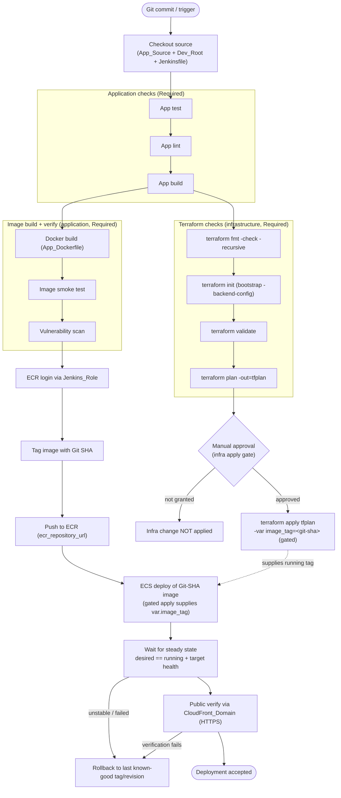

# Design Document

## Overview

This design describes the Jenkins CI/CD Pipeline for the Erudition Solution development environment. The
Pipeline is defined by a single repository-root `Jenkinsfile`; Jenkins is the mandated platform and no other
CI/CD system (AWS CodePipeline, GitHub Actions, or otherwise) is introduced. The Pipeline targets the
development environment only: its Terraform working directory is the Dev_Root at `ecs-terraform/envs/dev/`,
and its application source is the Next.js App_Source at `ecs-application/`. No staging or production stages
are defined.

The Pipeline creates no application infrastructure. It reuses the Backend_Module (spec 03-backend), which
already provisions the ECR repository (`${name_prefix}-app`, `scan_on_push = true`, MUTABLE tags in DEV), the
internal ALB with an IP target group health-checked on `var.health_check_path`, and the ECS Fargate
cluster/service/task-definition with autoscaling. It consumes the Dev_Root outputs `ecr_repository_url`,
`ecs_cluster_name`, `ecs_service_name`, and `cloudfront_domain_name` at runtime via `terraform output`;
it hardcodes none of those values, no account ID, no ARN, and no registry URL.

Optionally, the CICD_Module at `ecs-terraform/modules/cicd/` (currently empty) MAY provision **only** the
infrastructure Jenkins needs — chiefly the least-privilege Jenkins_Role — but MUST NOT contain the Pipeline
definition. The Pipeline always lives in the repository-root `Jenkinsfile`.

A central design principle is the separation of two concerns that share the same repository but must never
be conflated:

- **Infrastructure changes** are Terraform operations against the Dev_Root. They are gated behind an
  explicit human approval step; `terraform apply` never runs automatically after a successful
  `terraform plan`.
- **Application releases** build, scan, push, and deploy an immutable container image. In the ownership
  model chosen below (Terraform owns the task definition), an application release is expressed as a gated
  `terraform apply` that carries the new Git-SHA image tag, so infrastructure planning and application
  deployment remain logically distinguishable while a single owner writes the running tag.

### Requirements addressed

This design maps to all 11 requirements in `requirements.md`, referenced inline as `(R<n>.<m>)`. It resolves
the open decisions from the Cross-Module Dependencies and Open Questions section into concrete DEV
recommendations, while restating the residual operator choices in **Open Decisions and Prerequisites**.

---

## Architecture

### Pipeline flow



**Infrastructure vs application stages.** The Terraform check stages (`fmt`/`init`/`validate`/`plan`), the
manual approval gate, and `terraform apply` are **infrastructure** concerns (R2, R11.2). The application
test/lint/build, Docker build/smoke/scan, ECR login/tag/push, ECS deploy, steady-state wait, and CloudFront
verification are **application-release** concerns (R1, R3, R4, R5). In the chosen ownership model the deploy
step is itself a gated `terraform apply` that supplies the new tag — this is the single point where the two
concerns intersect, and it remains behind the same human approval gate (R2.4, R9).

**Required-stage failure stops downstream stages.** Every Required_Stage (application tests, Terraform
checks, Docker build, image smoke test, vulnerability scan, ECR push, ECS deploy, deployment verification)
halts the Pipeline on non-zero exit; no dependent deployment stage runs after a failure, and no
failure-suppression pattern is used to force apparent success (R1.3, R3.4, R4.5, R6.1, R6.2).

**No hardcoded identifiers, role-based credentials.** Jenkins authenticates to AWS through the Jenkins_Role
(an assumed/instance IAM role), never static access keys (R4.3, R7.1). The registry URL, cluster name,
service name, and CloudFront domain are read at runtime from `terraform output` against the Dev_Root; none
are hardcoded (R4.4, R5.2, R8.3, R11.4).

### Concern separation

```mermaid
flowchart LR
    subgraph Infra["Infrastructure (gated)"]
        P["terraform plan -out=tfplan"] --> G{"Manual approval"}
        G --> A["terraform apply tfplan"]
    end
    subgraph App["Application release"]
        B["Docker build"] --> S["Scan"] --> Push["Push (Git SHA)"] --> D["ECS deploy"]
    end
    A -. supplies var.image_tag .-> D
```

---

## Components and Interfaces

The Pipeline is a sequence of stages in the repository-root `Jenkinsfile`. Each stage consumes existing AWS
and Terraform interfaces; it creates none of them.

| Stage / component | Purpose | Interfaces consumed |
| --- | --- | --- |
| Checkout | Fetch App_Source, Dev_Root, and `Jenkinsfile` at the commit under test | Git; the Git commit SHA becomes the Image_Tag |
| Application test / lint / build | Verify application code before any image is built | App_Source `package.json` scripts (`test`*, `lint`, `build`); Node.js/npm on the agent |
| Terraform fmt/init/validate/plan | Verify and plan the Dev_Root infrastructure | Terraform (`~> 1.16`); State_Backend S3 bucket + DynamoDB lock table (via `init -backend-config`); dev state key `ecs-dev/terraform.tfstate` |
| Manual approval gate | Require a human before any `terraform apply` | Jenkins `input` step; the Plan_Artifact `tfplan` |
| terraform apply (gated) | Apply the reviewed plan and set the running image tag | Terraform; Plan_Artifact `tfplan`; `var.image_tag=<git-sha>` |
| Docker build / smoke test | Build and smoke-test the container image | App_Dockerfile (`ecs-application/Dockerfile`); Docker on the agent |
| Vulnerability scan | Reject images at/above the severity threshold | ECR `scan_on_push` findings and/or an in-pipeline scanner |
| ECR login / tag / push | Authenticate and publish the immutable image | Jenkins_Role; `ecr_repository_url` from `terraform output`; AWS CLI |
| ECS deploy | Roll the Git-SHA image to the service | `ecs_cluster_name`, `ecs_service_name` from `terraform output`; the gated apply that supplies `var.image_tag` |
| Steady-state wait / health verify | Confirm the deployment is healthy | ECS service state (desired vs running); ALB target health; AWS CLI |
| Public verification | Confirm the app is reachable publicly | `cloudfront_domain_name` from `terraform output` (HTTPS request) |
| Rollback | Restore the last known-good version on failure | Previous Git-SHA tag / previous task-definition revision |

### Application test stage behavior (prerequisite)

The App_Source `package.json` (`erudition-solution-nextjs`) currently defines `dev`, `build`, `start`, and
`lint`, but **no `test` script and no test framework** (R1.5). This design treats a real application test
setup as a **prerequisite**: a minimal `test` script plus a test framework (for example Jest or Vitest with
one smoke test) MUST be added to the App_Source before the test stage can pass on real tests.

Until that prerequisite is satisfied, the test stage MUST **fail** rather than silently pass (R1.4). The
Pipeline does not adopt a silent-pass. The only sanctioned alternative is an **explicit, documented no-tests
gate** — a named, logged parameter that a human sets deliberately to permit continuation while the
prerequisite is outstanding. The recommended DEV default is to require the test setup rather than run with
the gate open. The Terraform quality suite runs against the Dev_Root only, never a staging or production
directory (R1.6).

---

## Data Models

The Pipeline stores no secrets and persists no long-lived state of its own. It passes a small set of
identifiers and artifacts between stages:

| Value | Source | Role in the Pipeline |
| --- | --- | --- |
| `git_commit_sha` | Git checkout | The immutable Image_Tag the deployment relies on (R4.1); never `latest` for version identification (R4.2) |
| `ecr_repository_url` | `terraform output` (Dev_Root) | Target registry for tag/push; not hardcoded (R4.4) |
| `ecs_cluster_name` | `terraform output` (Dev_Root) | ECS deploy target; not hardcoded (R5.2) |
| `ecs_service_name` | `terraform output` (Dev_Root) | ECS deploy target; not hardcoded (R5.2) |
| `cloudfront_domain_name` | `terraform output` (Dev_Root) | Public verification entry point; internal ALB/ECS never used for verification (R5.5) |
| `tfplan` (Plan_Artifact) | `terraform plan -out=tfplan` | Reviewed plan consumed unchanged by the gated apply (R2.3) |
| `previous_image_tag` / previous task-def revision | ECS `describe-services` before deploy | Last known-good target for rollback (R6.3) |
| AWS credentials | Jenkins_Role (assumed/instance role) | Never static keys, never stored in files or logs (R4.3, R7.3, R7.5) |

No secret value is stored in the Jenkinsfile, Terraform, the App_Dockerfile, the application source, or any
committed file. Where a secret is required it is obtained from Jenkins Credentials or AWS Secrets Manager at
runtime and never echoed to logs (R7.3, R7.4, R7.5).

---

## Pipeline Stages

Each stage below lists its purpose, inputs, success/fail behavior, and the requirements it satisfies. AWS
actions are described conceptually; exact command wiring lives in the future `Jenkinsfile`.

### 1. Checkout

- **Purpose:** Fetch App_Source, Dev_Root, and `Jenkinsfile` at the commit under test.
- **Inputs:** Git repository, target ref.
- **Success:** Working tree present; `git_commit_sha` captured as the Image_Tag.
- **Fail:** Checkout error stops the Pipeline.
- **Requirements:** R4.1, R11.5.

### 2. Application test / lint / build

- **Purpose:** Verify application code before building an image.
- **Inputs:** App_Source, Node.js/npm.
- **Commands (conceptual):** `npm ci`, `npm test`*, `npm run lint`, `npm run build`.
- **Success:** All three application checks exit zero.
- **Fail:** Any non-zero exit stops the Pipeline; a missing `test` script fails the test stage (no silent
  pass) unless the documented no-tests gate is explicitly set.
- **Requirements:** R1.1, R1.3, R1.4, R1.5.

### 3. Terraform quality suite (infrastructure)

- **Purpose:** Verify and plan Dev_Root infrastructure.
- **Inputs:** Dev_Root, Terraform, State_Backend.
- **Commands:**
  - `terraform fmt -check -recursive`
  - `terraform init` with the bootstrap `-backend-config` (S3 bucket, dev state key
    `ecs-dev/terraform.tfstate`, DynamoDB lock table)
  - `terraform validate`
  - `terraform plan -out=tfplan`
- **Success:** All commands exit zero; `tfplan` Plan_Artifact produced.
- **Fail:** Any non-zero exit stops the Pipeline; run only against the Dev_Root.
- **Requirements:** R1.2, R1.3, R1.6, R8.4, R10.4.

### 4. Manual approval gate (infrastructure)

- **Purpose:** Require an explicit human decision before any `terraform apply`.
- **Inputs:** The `tfplan` Plan_Artifact.
- **Success:** A human approves; the Pipeline proceeds to apply the same reviewed plan.
- **Fail / not granted:** No `terraform apply` runs; the infrastructure change is treated as not applied.
- **Requirements:** R2.1, R2.2, R2.5.

### 5. terraform apply (gated infrastructure / release)

- **Purpose:** Apply the reviewed plan and, in the chosen ownership model, set the running image tag.
- **Inputs:** The approved `tfplan`; `var.image_tag=<git-sha>`.
- **Commands:** `terraform apply tfplan` (applies the exact reviewed plan; supplies the Git-SHA tag via
  `-var="image_tag=<git-sha>"` or an equivalent `*.auto.tfvars` mechanism so exactly one owner writes the
  tag).
- **Success:** Apply completes; the service targets the new task definition.
- **Fail:** Apply error stops the Pipeline.
- **Requirements:** R2.3, R2.4, R9.2, R9.3.

### 6. Docker build / image smoke test (application)

- **Purpose:** Build the container image and verify it starts and responds.
- **Inputs:** App_Dockerfile, Docker.
- **Commands (conceptual):** `docker build`, then a smoke run against the container (for example start the
  container and probe the health path).
- **Success:** Image builds and passes the smoke check.
- **Fail:** Build or smoke failure stops the Pipeline before any push.
- **Requirements:** R3.1, R3.2.

### 7. Vulnerability scan (application)

- **Purpose:** Reject images with findings at or above the severity threshold before any deploy.
- **Inputs:** The built image; ECR `scan_on_push` and/or an in-pipeline scanner.
- **Success:** No findings at/above the threshold.
- **Fail:** Findings at/above the threshold stop the Pipeline; no push, no deploy.
- **Requirements:** R3.3, R3.4, R3.5, R3.6.

### 8. ECR login / tag / push (application)

- **Purpose:** Authenticate to ECR and publish the immutable image.
- **Inputs:** Jenkins_Role; `ecr_repository_url` from `terraform output`.
- **Commands (conceptual):** `aws ecr get-login-password | docker login`, `docker tag <image>
  <ecr_repository_url>:<git-sha>`, `docker push <ecr_repository_url>:<git-sha>`. An optional `latest` tag is
  convenience only and is never the version the deploy relies on.
- **Success:** Image present in ECR under the Git-SHA tag.
- **Fail:** Auth or push failure stops the Pipeline before ECS deploy.
- **Requirements:** R4.1, R4.2, R4.3, R4.4, R4.5.

### 9. ECS deploy (application)

- **Purpose:** Roll the Git-SHA image to the existing ECS service without architectural change.
- **Inputs:** `ecs_cluster_name`, `ecs_service_name` from `terraform output`; the gated apply supplying
  `var.image_tag`.
- **Commands (conceptual):** In the chosen ownership model the deploy is the gated `terraform apply`
  (`terraform apply tfplan -var="image_tag=<git-sha>"`), which registers the new task definition
  (`register-task-definition` equivalent) and updates the service. `aws ecs update-service` /
  `register-task-definition` are described conceptually as what Terraform performs on the operator's behalf;
  the Pipeline does not run a second, competing `update-service` that writes the tag.
- **Success:** Service accepts the new task definition; Fargate, private subnets, `assign_public_ip = false`,
  and the internal ALB are unchanged.
- **Fail:** Deploy failure stops the Pipeline and triggers rollback.
- **Requirements:** R5.1, R5.2, R9.3, R11.3.

### 10. Steady-state wait and health verification (application)

- **Purpose:** Confirm the deployment reaches a healthy steady state.
- **Inputs:** ECS service state; ALB target health.
- **Commands (conceptual):** `aws ecs wait services-stable`; `aws ecs describe-services` to compare desired
  vs running task counts and detect failed tasks; `aws elbv2 describe-target-health` for the deployed tasks.
- **Success:** Service stable, desired == running, no failed tasks, targets healthy.
- **Fail:** Any unmet condition marks the deployment failed and triggers rollback.
- **Requirements:** R5.3, R5.4, R5.6.

### 11. Public verification (application)

- **Purpose:** Confirm the application is publicly reachable through the intended entry point.
- **Inputs:** `cloudfront_domain_name` from `terraform output`.
- **Commands (conceptual):** An HTTPS request (for example `curl`) to the CloudFront domain, asserting an
  expected response. The internal ALB and ECS tasks are never targeted directly.
- **Success:** CloudFront returns the expected healthy response.
- **Fail:** Verification failure triggers rollback.
- **Requirements:** R5.5.

### 12. Rollback (on failure)

- **Purpose:** Restore the last known-good version if the deployment is failed or unstable.
- **Inputs:** `previous_image_tag` / previous task-definition revision.
- **Behavior:** See **Rollback Strategy**.
- **Requirements:** R6.3.

---

## Task-Definition Ownership Strategy

Requirement 9 requires exactly one owner of the running image tag. Today the Task_Definition image is
Terraform-managed via `"${aws_ecr_repository.app.repository_url}:${var.image_tag}"`, the service pins
`task_definition = aws_ecs_task_definition.app.arn`, and there is no `lifecycle { ignore_changes }`. A
Jenkins-driven `update-service` and a later `terraform apply` would therefore revert each other (R9.1).

**Chosen model (DEV default): option (a) — Terraform owns the task definition.** Jenkins supplies the
immutable Git-SHA image tag into Terraform via `var.image_tag` on the gated apply. This matches the current
module, which already parameterizes `var.image_tag` and pins
`task_definition = aws_ecs_task_definition.app.arn`. Terraform is the single source of truth for the running
tag, so there is no drift and no configuration with two writers (R9.2, R9.3, R9.4).

**How a pure application release flows in this model.** The deploy stage runs the gated `terraform apply`
with `-var="image_tag=<git-sha>"` (or an equivalent `*.auto.tfvars` written from the build). Terraform
registers a new task-definition revision referencing the Git-SHA image and updates the service to it.
Because the tag is written only through Terraform, exactly one owner writes it.

**Consequence to state explicitly.** In this model an application deploy **also passes through the
approval-gated apply**. There is no separate un-gated application-only deploy path in DEV. This is the
intended trade-off: it guarantees a single owner and drift-free deployments at the cost of routing every
release through the human gate.

**Trade-off vs option (b) — `ignore_changes`.** Option (b) adds
`lifecycle { ignore_changes = [task_definition] }` (and/or ignoring the container image) so Jenkins owns
image rollouts via new task-definition revisions produced with `register-task-definition` /
`update-service`. That enables faster application-only deploys that skip the Terraform gate, but a subsequent
`terraform plan` then shows drift/diff between the deployed image and the Terraform-tracked image, which the
operator must reconcile. Because DEV values determinism and a single source of truth over deploy speed,
option (a) is the default. If faster app-only deploys become a requirement later, option (b) is the
migration path, adopted deliberately with the drift trade-off understood.

Under either model, the design guarantees **no configuration has two owners writing the tag** (R9.4).

---

## Rollback Strategy

Requirement 6 requires a defined rollback that restores the last known-good version and does not suppress
failures.

**Primary (recommended): ECS deployment circuit breaker with rollback.** Enable
`deployment_circuit_breaker { enable = true, rollback = true }` on the ECS service in the Backend_Module
(03-backend). When a rollout fails to stabilize, ECS automatically rolls back to the last known-good
task-definition revision. This is a **small, additive cross-module change to 03-backend** — it is flagged
here as a required prerequisite and is **not implemented in this spec** (R6.5, and see **Open Decisions and
Prerequisites**).

**Fallback: Jenkins-driven redeploy of the last known-good version.** If the Pipeline itself detects an
unstable deployment (steady-state wait fails, desired != running, target health not achieved, or CloudFront
verification fails) and the circuit breaker has not already restored service, Jenkins deterministically
redeploys the previous known-good version. In the chosen ownership model this is a **`terraform apply` with
the previous known-good `var.image_tag`** (the `previous_image_tag` captured before deploy), so the fallback
respects the single-owner rule — Terraform still writes the tag. Equivalently, the previous task-definition
revision captured from `describe-services` identifies the known-good target.

**Interaction with the ownership model.** Because Terraform owns the tag (option (a)), both the circuit
breaker (ECS-native, revision-based) and the Jenkins fallback (`terraform apply` with the prior tag)
converge on the same known-good revision without creating a second writer of the running tag.

Failure handling stays non-suppressing: a failed or unstable deployment triggers rollback and the Pipeline
reports failure; it never masks the failure to appear successful (R6.1, R6.2, R6.3, R6.4).

---

## First-Deployment Bootstrap

Requirement 10 requires that a pullable image exists before the ECS service starts, because a service pinned
to a non-existent Image_Tag fails to start (R10.1, R10.2).

**Recommended ordering (DEV):**

1. **Bootstrap remote state.** The State_Backend (S3 bucket + DynamoDB lock table, dev state key
   `ecs-dev/terraform.tfstate`) is bootstrap-owned and MUST exist before the Pipeline runs
   `terraform init` against the Dev_Root. The Pipeline never creates or maintains separate local state
   (R10.4, R8.4).
2. **Create ECR first.** Apply Terraform so that at least the ECR repository (and supporting resources)
   exists before the ECS service is created. Because the service needs a pullable image, split the first
   apply using Terraform targeting so ECR is created ahead of the service — for example apply the ECR
   resource first (or apply the service with `desired_count = 0` initially).
3. **Seed the first image.** Jenkins builds the App_Dockerfile and pushes the image to the **Git-SHA tag**
   into the now-existing ECR repository. This is the seed image; it uses the same immutable-tag convention
   as every later release, so no placeholder `latest`-only image is relied upon for version identification.
4. **Create/scale the service on the seeded tag.** Apply the remainder of the Dev_Root with
   `var.image_tag=<git-sha>` (and `desired_count` at its DEV value), so the service starts against an image
   that already exists in ECR.

**Trade-offs.** Splitting the first apply (targeting ECR, or starting the service at `desired_count = 0`)
adds one extra ordered step but guarantees the service is never pinned to a missing tag. The alternative —
a single apply that creates ECR and the service together — fails on first start because no image exists yet;
this design rejects that path. A pure seed/placeholder image is possible but is not preferred, because
seeding directly to the Git-SHA tag keeps a single, consistent tagging scheme from the very first deployment.

This ordering makes the first-deployment failure condition of R10.2 unreachable: the service is only created
or scaled up after the Git-SHA image it references is present in ECR (R10.1, R10.3, R10.5).

---

## Security Design

- **Least-privilege Jenkins_Role.** Jenkins assumes an IAM role scoped to exactly what the Pipeline needs:
  ECR push/pull for the App_Repository, ECS describe/update/register for the specific cluster and service,
  read/write to the specific State_Backend S3 bucket and the DynamoDB lock table, and read of the required
  Dev_Root outputs. It attaches **no** `AdministratorAccess` and grants **no** unnecessary wildcard
  permissions or `Resource: "*"` (R7.1, R7.2).
- **Role over static keys.** Prefer an in-account agent using an instance/assumed role over static
  long-lived access keys. AWS credentials are never hardcoded in the Jenkinsfile, Terraform, the
  App_Dockerfile, or the application source (R4.3, R7.1, R7.3).
- **Secure secret handling.** Any required secret comes from Jenkins Credentials or AWS Secrets Manager at
  runtime; no secret value is stored in committed files, and secrets are never echoed to logs (R7.4, R7.5).
- **Image scanning before deploy.** The App_Repository already enables ECR `scan_on_push`; an optional
  in-pipeline pre-push scan MAY be added. Images with findings at or above the defined severity threshold
  are rejected before any push or deploy (R3.3, R3.4).
- **Private architecture preserved.** Public verification uses the CloudFront domain only; the ALB stays
  internal and ECS tasks stay private with `assign_public_ip = false`. The Pipeline makes no architectural
  change to simplify deployment (R5.1, R5.5, R11.3).
- **No hardcoded identifiers.** Account IDs, ARNs, ECR URLs, cluster/service names, and CloudFront
  identifiers all derive from Dev_Root outputs, Jenkins Credentials, or established interfaces (R4.4, R5.2,
  R8.3, R11.4).

---

## Error Handling

- **Required-stage failure stops the Pipeline.** A non-zero exit in any Required_Stage halts execution and
  blocks all dependent deployment stages (R1.3, R3.4, R4.5, R6.1).
- **No failure suppression.** The Pipeline never uses patterns that force apparent success; a real failure
  is reported as a failure (R6.2).
- **Diagnosable, secret-safe logs.** Stages log enough context to diagnose failures without printing
  credentials or secret values (R6.4, R7.5).
- **Failed/unstable deploy triggers rollback.** When steady state is not reached, desired != running, tasks
  fail, target health is not achieved, or CloudFront verification fails, the deployment is treated as failed
  and rollback runs (R5.6, R6.3).
- **Config verification vs runtime verification.** `terraform fmt`/`validate`/`plan` verify configuration
  only; they do not exercise runtime behavior. Runtime verification (ECS steady state, desired == running,
  ALB target health, CloudFront reachability) happens at deploy time. This design keeps the two distinct and
  does not treat a successful plan as evidence of a healthy deployment (R2.1, R5.3, R5.4, R5.5).

---

## Correctness Properties

These are testable pipeline invariants for the Jenkins CI/CD design, verified against Jenkinsfile
lint/replay, `terraform fmt`/`validate`/`plan`, IAM policy review, and deploy-time checks — not
property-based application tests. Each states a condition that must hold across all Pipeline runs.

### Property 1: Jenkins-only platform invariant

For any Pipeline definition, the CI/CD platform is Jenkins and no AWS CodePipeline, GitHub Actions, or other
CI/CD platform is introduced.

**Validates: Requirements 11.1**

### Property 2: Required-stage failure blocks downstream invariant

For any Pipeline run, if any Required_Stage exits non-zero, no dependent deployment stage runs afterward and
the Pipeline reports failure.

**Validates: Requirements 1.3, 3.4, 4.5, 6.1**

### Property 3: Apply-only-after-approval invariant

For any Pipeline run, `terraform apply` runs only after an explicit human approval is granted, and never
automatically upon a successful `terraform plan`.

**Validates: Requirements 2.1, 2.2, 2.5**

### Property 4: Reviewed-plan-artifact invariant

For any gated apply, `terraform apply` consumes the same reviewed Plan_Artifact (`tfplan`) produced by the
gated `terraform plan`, not a re-planned or different plan.

**Validates: Requirements 2.3**

### Property 5: Immutable Git-SHA tag invariant

For any deployed image, the deployment relies on the immutable Git commit SHA as the Image_Tag and never on
`latest` for version identification.

**Validates: Requirements 4.1, 4.2**

### Property 6: Role-based ECR authentication invariant

For any ECR authentication, the Pipeline uses the Jenkins_Role (IAM role credentials) and no static
long-lived AWS access keys.

**Validates: Requirements 4.3, 7.1, 7.3**

### Property 7: No-hardcoded-identifiers invariant

For any identifier the Pipeline consumes (registry URL, account ID, cluster name, service name, CloudFront
domain), the value derives from a Dev_Root output or established interface and appears nowhere as a hardcoded
literal.

**Validates: Requirements 4.4, 5.2, 8.3, 11.4**

### Property 8: Architecture-preservation invariant

For any ECS deployment, the service remains Fargate with tasks in private subnets, `assign_public_ip = false`,
and an internal ALB; the Pipeline makes no architectural change to simplify deployment.

**Validates: Requirements 5.1, 11.3**

### Property 9: Steady-state verification invariant

For any deployment, the Pipeline waits for the ECS service to reach a stable steady state and confirms the
desired task count equals the running task count with ALB target health achieved, detecting failed tasks.

**Validates: Requirements 5.3, 5.4, 5.6**

### Property 10: CloudFront-only public verification invariant

For any public application verification, the Pipeline verifies through the CloudFront_Domain and never
against the internal ALB or ECS tasks directly.

**Validates: Requirements 5.5**

### Property 11: Single-owner-of-tag invariant

For any run under the chosen ownership model, exactly one owner (Terraform via `var.image_tag`) writes the
running image tag, so Jenkins and Terraform never revert each other and no drift exists between the deployed
image and the Terraform-tracked image.

**Validates: Requirements 9.2, 9.3, 9.4**

### Property 12: Rollback-on-failure invariant

For any deployment reported failed or unstable, the Pipeline (via the ECS circuit breaker and/or a
Terraform-based Jenkins fallback) rolls back to the previous known-good task-definition revision or image,
without suppressing the failure.

**Validates: Requirements 6.2, 6.3**

### Property 13: Least-privilege-role invariant

For any Jenkins_Role policy, the role attaches no `AdministratorAccess`, grants no unnecessary wildcard
permissions, and is scoped to exactly the ECR, ECS, State_Backend S3/DynamoDB, and output-read actions the
Pipeline needs.

**Validates: Requirements 7.1, 7.2**

### Property 14: No-secrets-in-logs-or-files invariant

For any Pipeline run, no AWS credential or secret value is hardcoded in the Jenkinsfile, Terraform,
App_Dockerfile, or application source, and no secret value appears in pipeline logs.

**Validates: Requirements 7.3, 7.4, 7.5**

### Property 15: First-image-before-service invariant

For the first deployment, a pullable Git-SHA image exists in the App_Repository before the ECS service is
created or scaled up, so the service is never pinned to a non-existent tag.

**Validates: Requirements 10.1, 10.2, 10.3**

### Property 16: Pipeline-location invariant

For any Pipeline definition, the Pipeline lives in the repository-root `Jenkinsfile` and is not placed inside
any Terraform module (including the CICD_Module).

**Validates: Requirements 8.5, 11.5**

### Property 17: DEV-only-scope invariant

For any Pipeline run, the Terraform quality suite and deployment target the Dev_Root (`ecs-terraform/envs/dev/`)
only, with no staging or production stages and the bootstrap-owned State_Backend (no separate local state).

**Validates: Requirements 1.6, 8.4, 11.2**

These properties are verified by pipeline dry-runs and Jenkins pipeline lint/replay, by
`terraform fmt`/`validate`/`plan` on the Dev_Root, by IAM policy review of the Jenkins_Role, and by
deploy-time checks (ECS steady-state, desired == running, ALB target health, CloudFront reachability). They
are configuration and operational invariants, not executable property-based tests: the Pipeline is
declarative automation and infrastructure, not a pure input/output function, so PBT does not apply.

---

## Testing Strategy

Because the Pipeline is CI/CD automation over declarative infrastructure, property-based testing does not
apply. Verification confirms the design without running `terraform apply` or performing a real deployment in
this spec.

- **Jenkinsfile lint / pipeline replay.** Validate the `Jenkinsfile` syntax and stage graph, and replay the
  pipeline in a dry-run mode to confirm stage ordering, the required-stage gating, and the manual approval
  gate before any apply.
- **Terraform checks.** Run `terraform fmt -check -recursive`, `terraform init` (bootstrap backend),
  `terraform validate`, and `terraform plan -out=tfplan` against the Dev_Root to confirm the infrastructure
  concern is well-formed and the plan artifact is produced.
- **IAM policy review.** Review the Jenkins_Role policy for least privilege: no `AdministratorAccess`, no
  wildcard/`Resource: "*"`, and scoping limited to the ECR, ECS, S3 state bucket, DynamoDB lock, and output
  actions the Pipeline needs.
- **Deploy-time verification (design-defined, executed at real deploy time).** `aws ecs wait
  services-stable`, `aws ecs describe-services` for desired == running and failed-task detection,
  `aws elbv2 describe-target-health` for target health, and an HTTPS request to `cloudfront_domain_name`.

No `terraform apply` and no real ECS deployment are performed as part of this spec; the deploy-time checks
are specified here and executed only when the Pipeline runs against live infrastructure.

---

## Open Decisions and Prerequisites

### Residual operator decisions

1. **Application test framework.** Choose the test framework and add a `test` script (for example Jest or
   Vitest with an initial smoke test) to the App_Source (R1.5, Open Question 1).
2. **Whether to adopt option (b) later.** The DEV default is option (a) (Terraform owns the tag). If faster
   app-only deploys are later required, decide whether to migrate to option (b) (`ignore_changes`) with the
   understood plan-drift trade-off (R9, Open Question 2).
3. **Vulnerability-scan threshold and tool.** Finalize the exact severity threshold that fails the Pipeline
   and whether an in-pipeline pre-push scanner is used in addition to ECR `scan_on_push` (R3.5, R3.6, Open
   Question 6).
4. **CICD_Module scope.** Decide whether `ecs-terraform/modules/cicd/` provisions the Jenkins_Role now or
   later; in all cases the Pipeline stays in the repository-root `Jenkinsfile` (R8.5, R8.6, Open Question 5).
5. **Jenkins agent hosting / role delivery.** Decide whether Jenkins runs on an in-account EC2 agent
   assuming an instance/IAM role versus an external agent, since this changes how the least-privilege
   credentials are delivered (R7, Open Question 7).
6. **First-image seeding mechanism.** Confirm the precise seeding step — build+push to the Git-SHA tag with
   ECR created first, or start the service at `desired_count = 0` then scale up — from the ordering
   recommended in **First-Deployment Bootstrap** (R10.5, Open Question 4).

### Prerequisites (outside this spec)

- **Add an application test script + framework** to the App_Source so the test stage can pass on real tests
  (R1.5).
- **Add `deployment_circuit_breaker { enable = true, rollback = true }`** to the ECS service in the
  03-backend module as the primary automatic rollback — a small additive cross-module change, not
  implemented here (R6.5).
- **Bootstrap the remote State_Backend** (S3 bucket + DynamoDB lock, dev state key
  `ecs-dev/terraform.tfstate`) before the Pipeline runs `terraform init` (R10.4).
- **Provision the Jenkins_Role and agent** (optionally via the CICD_Module) so the Pipeline can assume a
  least-privilege role (R7, R8.5).
