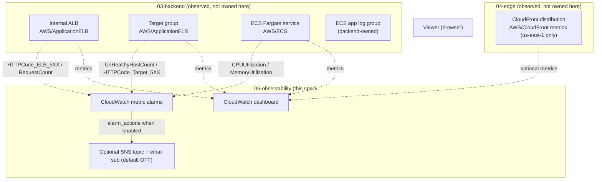
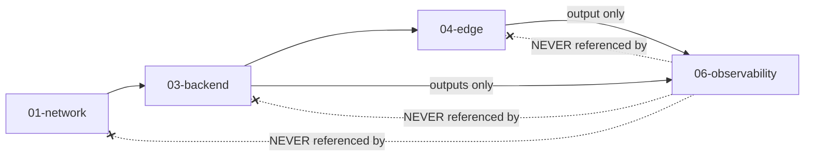

# Design Document

## Overview

This design describes a new reusable observability module at
`ecs-terraform/modules/observability/`, composed by the Terraform root module at
`ecs-terraform/envs/dev/`. The `Observability_Module` adds monitoring and alerting over the
already-deployed development architecture; it creates **no** application infrastructure.

The DEV request path it observes is unchanged:

```
Internet -> CloudFront (default *.cloudfront.net) -> CloudFront VPC Origin
         -> internal ALB (internal) -> ECS Fargate (private subnets)
         -> (NAT egress / TLS, outbound) -> MongoDB Atlas M0 (external managed service)
```

The module is purely observational. It **consumes** identifiers (ECS cluster/service names, ALB and
target-group ARN suffixes, the ECS application log group name, and optionally the CloudFront
distribution id) and **owns** only CloudWatch alarms, a single CloudWatch dashboard, and an optional,
default-off SNS notification path. It creates no ECS, ALB, ECR, S3, CloudFront, VPC, subnet, route
table, NAT gateway, internet gateway, VPC endpoint, or security-group resource (R2.1).

Two ownership boundaries are pinned before implementation because they shape the whole design:

1. **The ECS application log group already exists and is owned by the backend module.** The backend
   declares `aws_cloudwatch_log_group.app` named `"${local.name_prefix}-app"` with retention from the
   backend's `var.log_retention_days`. The observability module **MUST NOT** create or recreate it and
   **MUST NOT** declare any `aws_cloudwatch_log_group` for ECS application logs. It consumes the log
   group name only (R3.1, R3.2, R1.8).
2. **The ECS service already has an autoscaling CPU target-tracking policy owned by the backend
   module** (`aws_appautoscaling_policy.cpu`, `ECSServiceAverageCPUUtilization`). The CPU and memory
   alarms in this spec are **notification/visibility** alarms. They do not scale the service and do not
   create or modify any autoscaling policy or scalable target (R4.5, R1.8).

### Requirements addressed

This design maps to all 14 requirements in `requirements.md`, referenced inline as `(R<n>.<m>)`. It is
DEV-only: it creates no `envs/staging` or `envs/prod` and no staging/production resources. This spec
writes design only — no Terraform, no tasks, no `terraform apply`, no AWS resources, no state change.

---

## Architecture

### What is observed



MongoDB Atlas M0 is an external managed service that publishes no `AWS/*` metrics, so this spec creates
no Atlas alarms or widgets.

### Module / dev-root composition

```mermaid
flowchart LR
    subgraph DevRoot["ecs-terraform/envs/dev/"]
        Net["module.network"]
        Bak["module.backend"]
        Edg["module.edge"]
        Obs["module.observability"]
        Out["outputs.tf (re-export dashboard name + sns topic arn)"]
    end

    Bak -->|ecs_cluster_name, ecs_service_name,<br/>alb_arn_suffix, target_group_arn_suffix,<br/>ecs_log_group_name| Obs
    Edg -->|cloudfront_distribution_id (optional)| Obs
    Obs --> Out
```

### Dependency direction (no cycles)



The observability module is positioned strictly as a downstream consumer. The `network → backend → edge`
direction is preserved, and the network, backend, and edge modules hold zero references to observability,
so the module graph has no cycle (R2.5, R2.6, R11.6). All identifiers reach the module through its own
input variables, supplied only by the dev root from other modules' outputs (R2.2, R2.3, R2.4).

---

## Components and Interfaces

### Module file layout

Terraform loads every `.tf` file in the module directory as one module; the split below exists for
readability, and no file is created solely to isolate a trivial block (project conventions):

| File | Contents | Why separate |
| --- | --- | --- |
| `cloudwatch_alarms.tf` | The six `aws_cloudwatch_metric_alarm` resources (CPU, memory, unhealthy host, target 5xx, ELB 5xx, latency) **and** the `terraform {}` required-providers block plus the `locals { name_prefix }` block | The alarms are the module's primary resource set. Following the backend's standard (see `modules/backend/ecs.tf`), the required-version/providers block and the `name_prefix` local live inside a real resource file rather than an organizational-only `versions.tf`/`locals.tf` |
| `dashboard.tf` | The single `aws_cloudwatch_dashboard` and its `jsonencode` body / widget locals | The dashboard JSON is large and self-contained; keeping it apart keeps the alarms readable |
| `sns.tf` | The optional `aws_sns_topic` and `aws_sns_topic_subscription`, count-gated by `enable_sns`, and the `local.alarm_actions` list consumed by the alarms | Notification path is an isolated, optional concern that is entirely absent when SNS is off |
| `variables.tf` | All typed, validated input variables | Standard module convention |
| `outputs.tf` | `dashboard_name` and `sns_topic_arn` | Standard module convention |

The module declares **no** backend block and **no** `provider` block; it inherits the default AWS
provider configured in `envs/dev/providers.tf` (R1.5).

### Naming and tags

A single local derives every resource name (matching the backend's pattern):

```hcl
locals {
  name_prefix = "${var.app_name}-${var.environment}"
}
```

`app_name` is validated against `^[a-z][a-z0-9-]{1,30}[a-z0-9]$` and `environment` against the set
`dev|staging|prod` so names stay consistent and valid (R1.2). Every taggable resource merges the common
tag set (`Project`, `Environment`, `ManagedBy`, `Owner`) passed from the dev root with a resource-specific
`Name` tag (R1.6).

### Non-duplication: consume, never recreate (R3)

The module needs the ECS application log group **name** (for Logs Insights scoping and documentation),
not a log-group resource. It obtains that name from exactly one source — the new backend output
`ecs_log_group_name` (preferred), or, equivalently, a single typed `ecs_log_group_name` input the dev
root fills from `module.backend.ecs_log_group_name`. The module **never** calls
`aws_cloudwatch_log_group` for ECS application logs (R3.1, R3.2). The input is validated non-empty/non-null
(R3.3). The backend remains the sole owner of that log group and its retention (R3.4).

This spec creates **no** observability-owned log group. (If a future, separately justified log group were
added, it would carry a finite `retention_in_days` from a typed variable in the allowed CloudWatch set,
never never-expire — R3.5, R10.3, R13.2.)

### Alarms (R4–R7, R10, R14)

All six alarms are `aws_cloudwatch_metric_alarm` resources using `comparison_operator =
"GreaterThanOrEqualToThreshold"`, `treat_missing_data = "notBreaching"`, and
`alarm_actions = local.alarm_actions` (the SNS topic ARN list when enabled, else `[]` — see SNS section).
Every threshold, period, and evaluation-periods value is a typed, validated variable; no literal constant
appears in module source (R10.1). Each alarm maps to exactly one student-impact operational reason (R10.6):

| Alarm | Namespace / Metric | Stat | Dimensions | Default threshold | Default period / eval | Operational reason (student impact) |
| --- | --- | --- | --- | --- | --- | --- |
| `CPU_Alarm` | `AWS/ECS` / `CPUUtilization` | `Average` | `ClusterName`, `ServiceName` | 80 (%) | 60s / 3 | Compute saturation can slow or interrupt a live assessment |
| `Memory_Alarm` | `AWS/ECS` / `MemoryUtilization` | `Average` | `ClusterName`, `ServiceName` | 80 (%) | 60s / 3 | Memory exhaustion can OOM a task and drop a submission |
| `Unhealthy_Host_Alarm` | `AWS/ApplicationELB` / `UnHealthyHostCount` | `Maximum` | `TargetGroup`, `LoadBalancer` | 1 | 60s / 2 | Lost API capacity: students can't reach the service |
| `Target_5xx_Alarm` | `AWS/ApplicationELB` / `HTTPCode_Target_5XX_Count` | `Sum` | `TargetGroup`, `LoadBalancer` | 5 | 300s / 2 | Application server errors break assessment submissions |
| `ELB_5xx_Alarm` | `AWS/ApplicationELB` / `HTTPCode_ELB_5XX_Count` | `Sum` | `LoadBalancer` only | small DEV value (e.g. 5) | 300s / 2 | Load-balancer-level failures mid-session, distinct from app errors |
| `Latency_Alarm` | `AWS/ApplicationELB` / `TargetResponseTime` | `p95` (extended percentile; configurable) | `TargetGroup`, `LoadBalancer` | 2 (seconds) | 60s / 3 | High tail latency slows or interrupts a student's live assessment and precedes timeouts/failed submissions |

Notes:

- CPU/memory thresholds are utilization percentages constrained to `0–100`; comparison is `>=` so the
  alarm breaches when the statistic meets or exceeds the threshold (R4.3, R4.4).
- `Unhealthy_Host_Alarm` uses `Maximum` and treats missing data as not breaching so absent datapoints
  never force it into ALARM (R5.5, R5.6).
- `Target_5xx_Alarm` and `ELB_5xx_Alarm` are **separate** resources: one is dimensioned by both
  `TargetGroup` and `LoadBalancer` (target-origin errors), the other by `LoadBalancer` only
  (load-balancer-origin errors) (R6.1, R7.1, R7.5).
- The ALB `LoadBalancer` dimension value is the ALB ARN **suffix** `app/<name>/<id>`; the `TargetGroup`
  dimension value is the target-group ARN **suffix** `targetgroup/<name>/<id>`. Both come from backend
  outputs (next section); none is hardcoded (R5.2, R6.1, R7.1, R1.7).
- These alarms are notification-only; the module creates no autoscaling policy or scalable target and does
  not touch the backend's existing target-tracking policy (R4.5, R1.8).
- `Latency_Alarm` uses the `TargetResponseTime` metric (in seconds) with a configurable extended-percentile
  statistic (default `p95`) so it reflects tail latency, uses `>=` comparison and
  `treat_missing_data = "notBreaching"`, obtains its `TargetGroup` + `LoadBalancer` dimensions from the
  backend ARN-suffix outputs (no hardcoding), and shares the same optional-SNS `alarm_actions` wiring (empty
  when `enable_sns = false`) (R14).

### Dashboard (R8)

Exactly one `aws_cloudwatch_dashboard`, named from `name_prefix` (R8.1). Widgets, with every dimension
sourced from inputs/references (never a hardcoded string — R8.6):

- ECS `CPUUtilization` and `MemoryUtilization`, each dimensioned by `ClusterName` + `ServiceName` (R8.2).
- ALB `RequestCount`, `HTTPCode_Target_5XX_Count`, `HTTPCode_ELB_5XX_Count`, and target-group
  `HealthyHostCount`, each dimensioned by the `LoadBalancer` suffix and, where applicable, the
  `TargetGroup` suffix (R8.3).
- **Optional** CloudFront widgets (request count + error rate from `AWS/CloudFront`), gated by a boolean
  (`enable_cloudfront_widgets`, default `false`). When enabled, each CloudFront widget sets its metric
  `region` to `us-east-1` in the widget definition, because CloudFront publishes `AWS/CloudFront` metrics
  only in `us-east-1` regardless of the deploy region (R8.4). When disabled, the dashboard contains ECS and
  ALB widgets only and no `AWS/CloudFront` widget (R8.5). The CloudFront distribution id comes from
  `module.edge` through an input; it is not hardcoded.

### Optional SNS notification path (R9, R13.5)

```hcl
variable "enable_sns" { type = bool, default = false }   # R9.1
```

- `enable_sns = false` (DEV default): the SNS resources use `count = 0`, so **zero** `aws_sns_topic` and
  **zero** `aws_sns_topic_subscription` exist, and `local.alarm_actions = []` so every alarm has an empty
  action list (R9.2).
- `enable_sns = true`: exactly one `aws_sns_topic` is created and `local.alarm_actions =
  [aws_sns_topic.alarms[0].arn]`, so every alarm references that one topic ARN (R9.3).
- `enable_sns = true` **and** `sns_notification_email` non-empty: exactly one email
  `aws_sns_topic_subscription` is created with that endpoint (R9.4). If the email is empty, the topic is
  created with zero subscriptions (R9.5).
- `sns_notification_email` is a typed `string` with no hardcoded default endpoint; the value is supplied
  only through the variable, and no secret is stored in Terraform (R9.6).
- The topic uses AWS-managed encryption (`kms_master_key_id = "alias/aws/sns"`); no customer-managed KMS
  key is created or referenced (R13.5).

The gating local keeps the alarm/SNS wiring declarative:

```hcl
locals {
  alarm_actions = var.enable_sns ? [aws_sns_topic.alarms[0].arn] : []
}
```

---

## Data Models

### Observability module input variables (`variables.tf`)

| Variable | Type | Default | Validation | Notes |
| --- | --- | --- | --- | --- |
| `app_name` | string | — | `^[a-z][a-z0-9-]{1,30}[a-z0-9]$` | Name prefix segment (R1.2) |
| `environment` | string | — | one of `dev\|staging\|prod` | Name prefix segment (R1.2) |
| `tags` | map(string) | `{}` | — | Common tag set from the root (R1.6) |
| `ecs_cluster_name` | string | — | non-empty | `ClusterName` dimension (R4.1) |
| `ecs_service_name` | string | — | non-empty | `ServiceName` dimension (R4.1) |
| `alb_arn_suffix` | string | — | non-empty | `LoadBalancer` dimension `app/<name>/<id>` (R5.1) |
| `target_group_arn_suffix` | string | — | non-empty | `TargetGroup` dimension `targetgroup/<name>/<id>` (R5.1) |
| `ecs_log_group_name` | string | — | non-empty/non-null | ECS app log group name, consumed only (R3.2, R3.3) |
| `cloudfront_distribution_id` | string | `null` | — | Only needed when CloudFront widgets enabled |
| `enable_cloudfront_widgets` | bool | `false` | — | Gates `AWS/CloudFront` widgets (R8.4, R8.5) |
| `cpu_alarm_threshold` | number | 80 | `>= 0 && <= 100` | Utilization % (R4.3, R10.5) |
| `memory_alarm_threshold` | number | 80 | `>= 0 && <= 100` | Utilization % (R4.3, R10.5) |
| `ecs_alarm_period` | number | 60 | CloudWatch-valid (10, 30, or multiple of 60 ≤ 86400) | ECS alarm metric period (R10.2) |
| `ecs_alarm_evaluation_periods` | number | 3 | `>= 1 && <= 5` | Consecutive periods (R10.2) |
| `unhealthy_host_threshold` | number | 1 | `>= 1 && <= 100` | Unhealthy host count (R5.3) |
| `unhealthy_host_period` | number | 60 | CloudWatch-valid, 60–86400 | (R5.4) |
| `unhealthy_host_evaluation_periods` | number | 2 | `>= 1 && <= 100` | (R5.4) |
| `target_5xx_threshold` | number | 5 | `>= 1 && <= 100000` | Target 5xx count (R6.2) |
| `target_5xx_period` | number | 300 | CloudWatch-valid, ≤ 86400 | (R6.3) |
| `target_5xx_evaluation_periods` | number | 2 | `>= 1 && <= 100` | (R6.3) |
| `elb_5xx_threshold` | number | 5 | `>= 1` | ELB 5xx count (R7.2) |
| `elb_5xx_period` | number | 300 | CloudWatch-valid | (R7.3) |
| `elb_5xx_evaluation_periods` | number | 2 | `>= 1 && <= 100` | (R7.3) |
| `latency_alarm_statistic` | string | `"p95"` | one of `p90`,`p95`,`p99` (extended percentile) | TargetResponseTime percentile (R14.2) |
| `latency_threshold_seconds` | number | 2 | `>= 0` | Seconds; `>=` comparison (R14.3) |
| `latency_alarm_period` | number | 60 | CloudWatch-valid | (R14.4) |
| `latency_alarm_evaluation_periods` | number | 3 | `>= 1 && <= 100` | (R14.4) |
| `enable_sns` | bool | `false` | — | Gates all SNS resources (R9.1) |
| `sns_notification_email` | string | `""` | — | Email endpoint; no hardcoded default (R9.6) |

Numeric inputs outside their bounded range fail `terraform validate` with a message naming the variable
and its permitted range (R10.4). Every threshold is non-negative and every period is a CloudWatch-valid
value (R10.5). No variable here carries a secret; the email endpoint is operational configuration, not a
secret, and nothing in this module references the MongoDB URI. If any future variable did carry a secret
it would be marked `sensitive = true` (R13.3).

### Observability module outputs (`outputs.tf`)

| Output | Value | Notes |
| --- | --- | --- |
| `dashboard_name` | `aws_cloudwatch_dashboard.main.dashboard_name` | Dashboard identifier (R12.5) |
| `sns_topic_arn` | `var.enable_sns ? aws_sns_topic.alarms[0].arn : null` | Null when SNS disabled; resolves without error (R12.6) |

No output is or derives from a secret value (R13.4).

### Additive backend output interface (R11)

The alarms and dashboard need ALB/target-group CloudWatch **dimension** values. CloudWatch dimensions use
the ARN **suffix** (`LoadBalancer = app/<name>/<id>`, `TargetGroup = targetgroup/<name>/<id>`), which the
backend does not currently output — it outputs the full `alb_arn` but no suffix, and no ECS log group
name. Rather than hardcode or derive by string surgery across a module boundary, the backend exposes three
**new, additive** outputs. The AWS provider exposes `arn_suffix` directly on both the load balancer and the
target group, so these are plain references:

```hcl
# modules/backend/outputs.tf — ADDITIVE ONLY
output "alb_arn_suffix" {
  description = "ARN suffix of the internal ALB (app/<name>/<id>), used as the CloudWatch LoadBalancer dimension by 06-observability."
  value       = aws_lb.app.arn_suffix
}

output "target_group_arn_suffix" {
  description = "ARN suffix of the application target group (targetgroup/<name>/<id>), used as the CloudWatch TargetGroup dimension by 06-observability."
  value       = aws_lb_target_group.app.arn_suffix
}

output "ecs_log_group_name" {
  description = "Name of the backend-owned ECS application log group, consumed (not recreated) by 06-observability."
  value       = aws_cloudwatch_log_group.app.name
}
```

Guarantees that make this safe (R11):

- **Additive only.** Every pre-existing backend output (`ecr_repository_url`, `alb_dns_name`, `alb_arn`,
  `ecs_cluster_name`, `ecs_service_name`) is unchanged in name and value (R11.4).
- **No resource change.** New outputs read existing resource attributes; they create, modify, replace, or
  destroy nothing. A `terraform plan` attributes zero adds/changes/destroys to this output change (R11.5).
- **No new dependency.** The backend gains no reference to the observability module; the direction stays
  one-way `backend → (outputs) → observability` (R11.6, R2.5).

### Dev-root wiring (R12)

`envs/dev/main.tf` adds exactly one `module "observability"` block sourced `../../modules/observability`,
with every identifier sourced from module outputs — never a literal (R12.1, R12.2, R12.3):

```hcl
module "observability" {
  source = "../../modules/observability"

  app_name    = var.app_name
  environment = var.environment
  tags = {
    Project     = var.app_name
    Environment = var.environment
    ManagedBy   = "Terraform"
    Owner       = var.owner
  }

  ecs_cluster_name        = module.backend.ecs_cluster_name
  ecs_service_name        = module.backend.ecs_service_name
  alb_arn_suffix          = module.backend.alb_arn_suffix
  target_group_arn_suffix = module.backend.target_group_arn_suffix
  ecs_log_group_name      = module.backend.ecs_log_group_name

  # Only consumed when CloudFront widgets are enabled.
  cloudfront_distribution_id = module.edge.cloudfront_distribution_id

  enable_sns             = var.enable_observability_sns   # DEV: false
  sns_notification_email = var.observability_sns_email    # DEV: ""
}
```

`envs/dev/variables.tf` declares each observability input the root sets with an explicit type and
description; `envs/dev/terraform.tfvars` assigns DEV values and sets `enable_observability_sns = false`
(R12.4). No secret value is placed in `terraform.tfvars` (R12.7). `envs/dev/outputs.tf` re-exports exactly
two observability values and nothing more (R12.5, R12.6):

```hcl
output "observability_dashboard_name" {
  description = "Name of the CloudWatch dashboard for the dev environment."
  value       = module.observability.dashboard_name
}

output "observability_sns_topic_arn" {
  description = "ARN of the alarm SNS topic; null while SNS is disabled in DEV."
  value       = module.observability.sns_topic_arn
}
```

---

## AI-Assisted CloudWatch Troubleshooting (Optional, Console-Only)

This section is **documentation of an optional operational workflow**, not provisioned infrastructure. It
layers on the **same** ECS application log group (`${name_prefix}-app`, backend-owned) and the same metrics
the alarms and dashboard already use. It adds **no** Terraform resource and changes nothing about the
alarms, dashboard, SNS path, or log group described above (requirement from Part 2 item 4).

### What it is

Amazon CloudWatch includes a built-in AI **Query generator** that turns a natural-language question into a
CloudWatch Logs Insights query. Operators use it to investigate the application logs without first knowing
the Logs Insights query syntax, and can optionally request a natural-language summary of the results.

Operator workflow:

1. Open the CloudWatch console → **Logs** → **Logs Insights**.
2. Select the ECS application log group `${name_prefix}-app` (keep investigations scoped to this one log
   group).
3. Choose the Query generator control (**Generate query**) in the query editor.
4. Type a natural-language question (examples below).
5. Review and edit the generated Logs Insights query before running it.
6. Run the query; optionally use the natural-language results summary.

### Verified facts (cite the AWS source)

Sources: AWS CloudWatch Logs User Guide on generating queries with natural language
([Query generator](https://docs.aws.amazon.com/AmazonCloudWatch/latest/logs/CloudWatchLogs-Insights-Query-Assist.html)),
the natural-language results summary (powered by Amazon Bedrock)
([results summary](https://docs.aws.amazon.com/AmazonCloudWatch/latest/logs/CloudWatchLogs-Insights-Query-Results-Summary.html)),
and the AWS announcement confirming pricing and regional availability
([regional availability](https://aws.amazon.com/about-aws/whats-new/2024/09/amazon-cloudwatch-language-query-generation-7-additional-regions)):

- The Query generator is reached from a **control in the console query editor** in Logs Insights (and
  Metrics Insights); it is a built-in capability.
- There is **no charge for using the Query generator** itself.
- Any query you then **execute** is billed at **standard CloudWatch Logs Insights pricing** (per GB of log
  data scanned).
- Availability is **region-dependent** (the capability has rolled out region by region); if the feature or
  region is unavailable, operators fall back to writing the Logs Insights queries manually (the manual
  equivalents are provided in every example below).
- The optional results summary is generated using Amazon Bedrock behind the console feature — operators use
  it from the console; **this spec provisions nothing for it**.

Because this is a built-in console capability, the design provisions **no** Amazon Bedrock resource, Amazon
Q, AI agent, OpenSearch, or any other paid AI infrastructure of its own — there is no Terraform resource for
it (Part 2 item 3). *Content was rephrased for compliance with licensing restrictions.*

### Terraform-managed vs manual/console-only (the boundary)

| Capability | How it exists | Managed by |
| --- | --- | --- |
| ECS application log group (`${name_prefix}-app`) | Terraform resource | **Backend module** (not observability) |
| CPU / memory / unhealthy-host / target-5xx / ELB-5xx / latency alarms | Terraform resources | **Observability module** |
| CloudWatch dashboard | Terraform resource | **Observability module** |
| Optional SNS topic + email subscription | Terraform resources (default off) | **Observability module** |
| Module wiring / inputs / outputs | Terraform | **Dev root + modules** |
| AI **Query generator** natural-language investigations | Console button, run on demand | **Manual / console-only** (no Terraform) |
| Natural-language **results summarization** | Console feature | **Manual / console-only** (no Terraform) |
| Ad-hoc Logs Insights querying | Console, run on demand | **Manual / console-only** (no Terraform) |

### Example investigations

Each example gives the natural-language prompt an operator types into Query generator, the equivalent Logs
Insights query (manual fallback), and what to look for. Queries are scoped to the ECS app log group
`${name_prefix}-app` and assume a FastAPI app shipping JSON-ish/stdout logs via the awslogs driver. Field
names (`status`, `path`, `latency_ms`, `level`) are placeholders — adjust to the app's actual log shape.

**(a) HTTP 500 errors**

- Prompt: "Show me requests that returned HTTP 500 errors in the last hour, newest first."
- Logs Insights:
  ```
  fields @timestamp, @message, status, path
  | filter status >= 500
  | sort @timestamp desc
  | limit 100
  ```
- Look for: a cluster of 5xx responses, which paths return them, and whether they line up in time with the
  `Target_5xx_Alarm` or `ELB_5xx_Alarm` firing.

**(b) Failed assessment submissions**

- Prompt: "Find errors related to assessment submission failures in the last hour."
- Logs Insights:
  ```
  fields @timestamp, @message, level, path
  | filter (level = "ERROR" or status >= 500)
    and (@message like /submit/ or path like /submission/)
  | sort @timestamp desc
  | limit 100
  ```
- Look for: stack traces or error messages on the submission path, and whether failures correlate with a
  deploy, a saturation alarm, or an Atlas connectivity error. **Do not** expect (or want) the submitted
  answers themselves in the logs — see Safeguards.

**(c) API latency**

- Prompt: "Show the slowest API requests in the last hour and their average latency by path."
- Logs Insights:
  ```
  fields @timestamp, path, latency_ms
  | filter ispresent(latency_ms)
  | stats avg(latency_ms) as avg_ms, max(latency_ms) as max_ms, count(*) as n by path
  | sort max_ms desc
  | limit 50
  ```
- Look for: paths with high `max_ms`/`avg_ms`, and whether latency rises alongside CPU/memory alarms or
  unhealthy hosts (compute saturation degrading the student experience).

**(d) ECS task failures / stops**

- Prompt: "Find application errors or crashes just before tasks stopped in the last few hours."
- Logs Insights:
  ```
  fields @timestamp, @message, level
  | filter level = "ERROR" or @message like /(?i)(exception|traceback|fatal|out of memory|oom)/
  | sort @timestamp desc
  | limit 100
  ```
- Look for: the last error a task logged before exiting. **Important:** task-stop metadata (the ECS
  `StoppedReason`, exit code, OOM flag) is **not** in the application log group — correlate with the ECS
  console (Cluster → Service → Tasks → stopped task → **StoppedReason**) or `aws ecs describe-tasks` to see
  why the task actually stopped.

### Safeguards against logging sensitive data

The AI workflow surfaces whatever is already in the logs, so the only reliable protection is to keep
sensitive data out of the logs in the first place. The application MUST NOT log:

- Student personal information (PII).
- Assessment answers / submitted responses.
- Credentials, secrets, connection strings, or tokens.

Design position:

- This is primarily an **application logging-hygiene responsibility**. The observability module only
  **reads** logs; it cannot retroactively make logged data safe.
- The application should redact or avoid PII and answer payloads in its logs.
- `MONGODB_URL` and any other secrets come from AWS Secrets Manager and must **never** be echoed to stdout
  (which would ship them to the log group via the awslogs driver).
- Natural-language queries and their summaries can expose anything present in the logs; treat a
  **log-hygiene review as a precondition** before using AI investigations.
- CloudWatch Logs **data protection / masking** is an available option but is **out of scope to provision**
  in this spec (document-only). This section does not weaken into provisioning any resource.

### Cost note (reconciling with Part 1)

This workflow preserves cost-optimized DEV defaults. The Query generator is free to use; executed queries
are billed at standard Logs Insights per-GB-scanned pricing. It introduces no recurring cost and no new
resource. The 7-day DEV log-retention recommendation below applies to the one ECS app log group these
investigations read.

---

## Error Handling

- **Validation-time rejection.** Out-of-range numeric inputs, an invalid `app_name`/`environment`, or an
  empty/null `ecs_log_group_name` fail `terraform validate` before any plan, with a message naming the
  offending variable (R1.4, R3.3, R10.4).
- **Missing metric data.** Every alarm sets `treat_missing_data = "notBreaching"` so absent datapoints
  (common in a low-traffic DEV environment, and before the ECS service runs tasks during bootstrap) never
  drive an alarm into ALARM on their own (R5.6, R6.4, R7.4).
- **SNS disabled.** With `enable_sns = false`, `alarm_actions` is `[]` and no notification is attempted;
  the re-exported `sns_topic_arn` resolves to `null` without a Terraform error (R12.6, R9.2).
- **CloudFront region.** CloudFront widgets explicitly pin the metric `region` to `us-east-1`; without that,
  widgets would silently show no data when the deploy region differs (R8.4).
- **Bootstrap window.** During first-deployment bootstrap (`desired_count = 0`), ECS publishes no
  service metrics; `notBreaching` prevents spurious alarms, and the dashboard simply shows empty series
  until tasks run.

---

## Cost Design

DEV is kept minimal and cost-conscious:

- **CloudWatch alarms** — six standard metric alarms, a small per-alarm monthly cost; the only unavoidable
  recurring cost of this module.
- **Dashboard** — one dashboard, a small monthly cost (the first few dashboards per account are typically
  within the free allowance).
- **SNS** — **off by default**, so zero SNS cost in DEV; enabling it adds a topic + email subscription at
  negligible cost.
- **Logs Insights queries** (including AI-assisted ones) — billed per GB of log data scanned at standard
  pricing, incurred only when an operator runs a query.
- No NAT gateway, VPC endpoint, oversized compute, or ALB access-log S3 bucket is introduced by this
  module.

### Log retention: 7-day DEV target (flagged reality)

This spec sets **7-day retention** as the cost-optimized DEV default. The ECS **application** log group is
owned by the **backend module**, which currently defaults `log_retention_days = 14`. To meet the 7-day DEV
target, the recommendation is for the **dev root** to set the backend `log_retention_days = 7` for DEV (and
any future observability-owned log group's retention to 7). This is documented intent only — **no code is
changed in this design-only spec**. Where retention is owned is explicit: ECS app-log retention stays in
the backend module; the observability module owns no ECS log group.

---

## Security Design

- **No public exposure.** The module creates no internet-reachable resource, no public endpoint, no public
  IP, and no resource policy granting an unrestricted principal without an account/VPC-scoping condition
  (R13.1).
- **Finite retention.** The module creates no ECS log group; any observability-owned log group it might add
  would carry a finite `retention_in_days` from the allowed CloudWatch set, never never-expire (R13.2).
- **No secret outputs.** No output is or derives from a secret (R13.4); the email endpoint is operational
  configuration, and any genuinely secret variable would be marked `sensitive = true` (R13.3).
- **SNS encryption.** When enabled, the SNS topic uses AWS-managed encryption (`alias/aws/sns`); no
  customer-managed KMS key is created or referenced (R13.5).
- **Secret hygiene.** The MongoDB URI and all secrets stay in Secrets Manager, referenced by ARN; nothing
  in this module or in `terraform.tfvars` stores a secret (R12.7), and the AI-troubleshooting section
  explicitly warns against secrets reaching the logs.

---

## Testing / Verification Strategy

This feature is **declarative Terraform Infrastructure-as-Code** — CloudWatch alarms, a dashboard, an
optional SNS path, and additive backend outputs. There is no runtime algorithm or data transformation whose
behavior varies with generated input, so **property-based testing does not apply**. Verification is the
Terraform workflow plus plan-JSON inspection (consistent with `requirements.md` → Correctness Properties /
Verification):

- **Formatting.** `terraform fmt -check -recursive` reports no changes for the module and the dev root.
- **Validation.** `terraform validate` succeeds on the dev root after the module is wired in; a bad numeric
  input or empty `ecs_log_group_name` fails validation with a variable-named message.
- **Plan — default DEV (`enable_sns = false`).** `terraform plan` / plan-JSON confirms the SIX alarms and
  one dashboard are planned, **no** SNS topic or subscription is planned, and every alarm has
  `alarm_actions = []`.
- **Plan — SNS enabled.** With `enable_sns = true` and a non-empty email, plan-JSON confirms exactly **one**
  SNS topic, exactly **one** email subscription, and every alarm's `alarm_actions` referencing that topic
  ARN.
- **Non-duplication.** Plan-JSON confirms the module plans **no** `aws_cloudwatch_log_group` for ECS app
  logs and **no** autoscaling policy or scalable target.
- **No hardcoding.** Review confirms all CloudWatch dimension values resolve from module inputs/outputs
  (ARN-suffix outputs), with no hardcoded ARNs, account IDs, resource names, or dimension strings.
- **Additive backend outputs.** `terraform plan` after adding `alb_arn_suffix`, `target_group_arn_suffix`,
  and `ecs_log_group_name` shows **0 to add, 0 to change, 0 to destroy** attributable to the outputs; all
  pre-existing outputs remain unchanged.
- **Boundary / no cycle.** Review confirms the module creates no application resource and that the network,
  backend, and edge modules contain no reference to the observability module; `terraform validate`/`plan`
  report no dependency cycle and preserve `network → backend → edge`.

Any resulting plan is additionally reviewed for unexpected destruction/replacement, unintended public
exposure, security-group or IAM changes, missing/indefinite retention, and resources outside DEV scope
before any later apply decision. This spec runs no `apply`, creates no AWS resources, and modifies no
state.
```