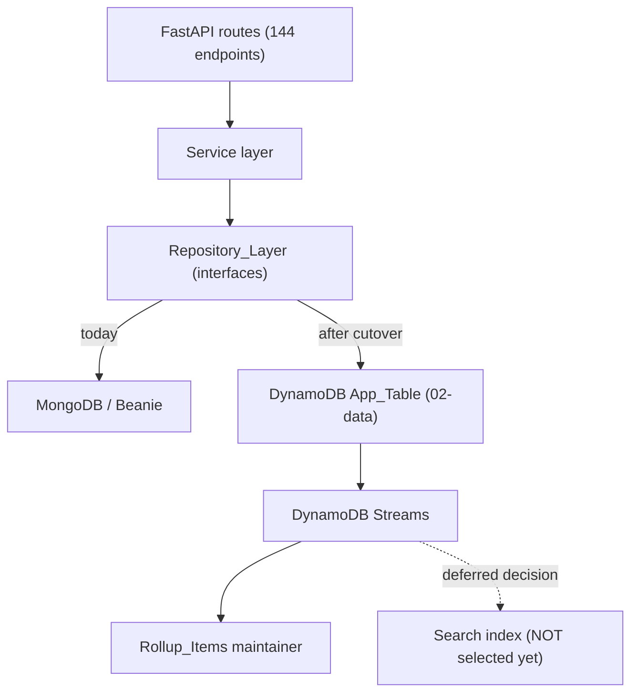

# Design Document

> **⚠️ SUPERSEDED (2026-10-19).** This specification is retained for historical
> reference only and must NOT be implemented. The project has standardized on
> **MongoDB Atlas (M0 free tier)** as the application's only database; the
> MongoDB→DynamoDB migration described below is cancelled, and the DynamoDB
> Terraform resources it depended on (the `02-data` data module) have been
> removed. For the current data architecture see `.kiro/steering/architecture.md`,
> `.kiro/steering/product.md`, and the `02-data` spec. The content below is left
> unchanged as a record of the previously proposed direction.

## Overview

This design covers the application-side migration of the Erudition Solution LMS backend
(`eruditiontx-services-mvp`) from MongoDB to DynamoDB, with DynamoDB as the system-of-record for
**all** MongoDB-dependent entities. The DynamoDB table resource is owned by `02-data`; this spec owns
the data-access layer, uniqueness/key design, search/aggregation replacements, ETL, and cutover.

This is a design document for a documentation-only Phase 1. It proposes changes; it implements none.
It preserves the backend's local Dockerfile edit and leaves `aws-production-deployment-course`
untouched.

## Verified preconditions

- **Terraform state (re-verified this session, not assumed):** account `691778449106`; bucket
  `eruditiontx-app-ecs-dev-tfstate-691778449106` -> HeadBucket 404; zero buckets in account; state
  key `ecs-dev/terraform.tfstate` -> HeadObject 404. Backend state is **not yet bootstrapped**. Any
  Terraform plan/apply for `02-data` schema changes remains blocked on bootstrap and is out of this
  spec's Phase 1.
- **ID reality:** the system already stores two id shapes — 24-hex ObjectId strings (local) and
  `auth0|...` strings (Auth0). See `user_id_helper.py`.

## Architecture

The migration introduces a datastore-agnostic Repository_Layer between the FastAPI route/service code
and the datastore. Today ~15 service files call Motor (`db[...]`) directly; those calls move behind
repository interfaces so the backing store (MongoDB today, DynamoDB after cutover) is swappable by
configuration.

Dependency direction: routes -> services -> Repository_Layer -> datastore. No service reaches past the
Repository_Layer to a datastore driver after migration. The App_Table resource stays owned by `02-data`;
this spec consumes it.

## Components and Interfaces

- **Repository_Layer** — one interface per aggregate (AccountRepo, UserRepo, ClassRepo, AssignmentRepo,
  SubmissionRepo, QuestionRepo, ThemeRepo, DistrictRepo, ...). Methods map to the LMS access patterns and
  return domain objects, hiding keys and id coercion. Centralizes the 211 `ObjectId(...)` coercions and
  the 30 `is_valid` checks.
- **UniquenessService** — issues `TransactWriteItems` for email/class-code reservations and the
  submission conditional create.
- **RollupMaintainer** — consumes DynamoDB Streams and applies idempotent, delta-based rollup updates.
- **BatchReader** — chunked `BatchGetItem` with `UnprocessedKeys` retry and input-order reconstruction.
- **ETL job** — one-time export/transform/load, plus a bounded incremental delta pass at cutover.
- **Datastore config flag** — selects MongoDB vs DynamoDB behind the Repository_Layer (the cutover flip).

## Data Models

### Entity / key model (single-table)

PK/SK prefixes are INTERNAL storage keys only; they never surface in the API (R2.2).

| Entity | Collection(s) | PK | SK | Notes |
|---|---|---|---|---|
| Account (staff/admin) | account_collection | `ACCOUNT#<id>` | `PROFILE` | email-unique via reservation |
| User (student/teacher) | user_collection | `USER#<id>` | `PROFILE` | email-unique; `auth0_user_id` alt-id |
| Class meta | class_collection | `CLASS#<id>` | `META` | class_code-unique via reservation |
| Class roster entry | (embedded students[]) | `CLASS#<id>` | `STUDENT#<studentId>` | roster as child items |
| Teacher -> class index | derived | `TEACHER#<id>` | `CLASS#<classId>` | teacher dashboards |
| Assignment | assignments_collection | `ASSIGN#<id>` | `META` | `assigned_class[]`, soft-delete |
| Class -> assignment index | derived | `CLASS#<id>` | `ASSIGN#<assignId>` | class assignment lists |
| Submission | submission_collection | `SUBMISSION#<assignmentId>#<studentId>` | `META` | uniqueness BY KEY (R3.2) |
| ShareRequest | sharerequest_collection | `SHAREREQ#<id>` | `META` | |
| Client | client_collection | `CLIENT#<id>` | `META` | |
| School | school_collection | `SCHOOL#<id>` | `META` | |
| District (+ feature flags) | district(s)_collection, district_feature(_flags)_collection, feature_collection | `DISTRICT#<id>` | `META` / `FEATURE#<key>` | staff/admin domain |
| Theme / UserTheme | themes_collection, user_themes_collection | `THEME#<id>` / `USERTHEME#<userId>` | `META` | see themes id audit |
| ClassMessage | class_message | `CLASS#<id>` | `MSG#<ts>#<id>` | |
| Question (teacher/global) | question_collection, teacher_questionbank, global_questionbank, global_assignments | `QUESTION#<id>` | `META` | BatchGet fan-out |
| Reservation (email) | n/a (new) | `RESV#EMAIL#<email>` | `RESV` | uniqueness item |
| Reservation (class code) | n/a (new) | `RESV#CLASSCODE#<code>` | `RESV` | uniqueness item |
| Rollup (per assignment) | n/a (new) | `ROLLUP#ASSIGN#<assignId>` | `AGG` | dashboard counters |
| Rollup (per class) | n/a (new) | `ROLLUP#CLASS#<classId>` | `AGG` | dashboard counters |

Proposed GSIs (owned by 02-data; this spec requests them):
- **GSI-teacher** — teacher -> classes/assignments listing.
- **GSI-assignment-submissions** — `ASSIGN#<id>` -> submissions (teacher gradebook / results).
- **GSI-question-filter** — coarse question-bank filter keys (type/subject/grade). NOT sufficient for
  free-text or facet counts (see Search section).
- Email/class-code uniqueness use **reservation items, NOT a GSI** (R3.1).

A full access-pattern table (AP-LMS-1..N) mapping each read to exactly one Query/GetItem construct will
be enumerated during detailed design; the skeleton above is the proposed starting point.

## Uniqueness: reservation items + transactional conditional writes (R3)

- **Email / class-code:** a write that must be unique issues a `TransactWriteItems` containing (a) a
  `Put` of the entity item and (b) a `Put` of the Reservation_Item (`RESV#EMAIL#<email>` /
  `RESV#CLASSCODE#<code>`) with `ConditionExpression = attribute_not_exists(PK)`. If the reservation
  already exists the whole transaction fails atomically -> no duplicate (R3.3). On legitimate change
  (email change, class-code reissue) a second transaction deletes the old reservation and creates the
  new one in one atomic step (R3.4).
- **Submission uniqueness:** encoded in the key `SUBMISSION#<assignmentId>#<studentId>` so there is one
  item per pair; the create uses `ConditionExpression = attribute_not_exists(PK)` (R3.2). This replaces
  the Mongo unique `(student_id, assignment_id)` index and directly addresses the EI-1195
  duplicate-submission class of bug by making duplicates structurally impossible.
- No unique GSI is used (DynamoDB has none).

## ID strategy and the ObjectId audit (R2)

**Audit results (measured):** 30 `ObjectId.is_valid` sites in 10 files; 211 `ObjectId(...)` coercions;
94 `PydanticObjectId` fields; heterogeneous id handling in `user_id_helper.py` (ObjectId OR `auth0|...`);
and a HARD 24-hex regex at `server/models/themes.py:337` (`^[0-9a-fA-F]{24}$`).

**Per-field identifier intent (established from code, task 1.4):** validation is NOT relaxed merely
because two id formats exist. Each id-bearing field is first classified by WHICH identifier it is
intended to accept:

- **Entity-reference fields** — `theme_id`, `client_id`, `school_id`, `district_id`, `feature_id`,
  `user_id`, `created_by`, document `id`/`_id`, `assignment_id`, `student_id`, `teacher._id`,
  `question_id` (all typed `PydanticObjectId` or ObjectId-validated). These reference a server-created
  entity whose id genuinely IS a 24-hex ObjectId. Their 24-hex validation (including the
  `themes.py:337` regex) is CORRECT for intent and MUST be preserved. Auth0 subjects never flow into
  these fields.
- **User-identifier field in requests** — `request.state.user_details["uuid"]`. The Auth0 bearer sets
  `uuid = mongodb_id` (the 24-hex ObjectId string), explicitly "for backward compatibility with
  existing service code that does `ObjectId(user_details["uuid"])`" (`auth0_bearer.py`). So the value
  services consume is the 24-hex entity id, not the Auth0 sub.
- **Auth0 alternate-key field** — `auth0_user_id` (`auth0|...`), a SEPARATE field used only for profile
  lookup. It is correctly typed as a free string and is never fed to ObjectId validators.

**Implications:**
- Existing ids are preserved verbatim as opaque strings; the stored id becomes `<id>` inside the key
  (R2.1). API id fields stay byte-compatible (R2.5) — response models already emit strings.
- The `themes.py:337` 24-hex regex is NOT relaxed: it validates an entity reference that is a real
  ObjectId. Correcting the earlier Phase 1 note, Auth0 ids do not reach it (R2.3).
- New entities created post-cutover keep whatever id scheme their entity type already uses; if a new
  opaque-string scheme is ever adopted for a specific entity, ONLY that entity's own reference
  validators are revisited — and only after confirming no field intends to accept a different
  identifier. A new scheme is NOT applied to user-identifier handling (which stays the mongodb_id
  string) (R2.3, R2.4).
- `PydanticObjectId` typed fields and the 211 coercions move behind the Repository_Layer so id parsing
  is centralized; the per-field intent table above is the authoritative map for what each accepts.

## Search, sampling, and aggregation replacements (R4)

### Text search + facets (`$regex` x16, `$facet`) — comparison only, NO selection (R4.1-R4.3)

| Option | Behavioral parity | Operating cost | Notes |
|---|---|---|---|
| External search engine (e.g. OpenSearch/managed Elasticsearch), fed by DynamoDB Streams | Highest — true text search, facets, relevance | Highest — always-on cluster/managed service + stream consumer | Closest to current `$regex`/`$facet`; NOT selected here |
| Precomputed search/facet items in DynamoDB (inverted-index items + counter items maintained on write) | Medium — exact-token/prefix match + maintained facet counts; weaker on fuzzy/substring | Low — pay-per-request only | Must enumerate which `$regex` uses are substring vs prefix |
| Bounded Query + client-side filter | Low — only works for small, well-partitioned candidate sets | Low | Risks scans / dropped matches if cardinality grows |

Decision is DEFERRED (R4.2). The design will NOT silently drop functionality: each of the 16 `$regex`
sites and the 2 `$facet` sites will be classified (substring vs prefix vs exact; facet vs page) so any
proposed reduction is explicit and signed off (R4.3).

### Adaptive/random sampling (`$sample` x3) (R4.4)

DynamoDB has no `$sample`. Replacement: bounded candidate Query (by skill/difficulty/type partition) then
application-side reservoir/random selection; or a random-shard key + random-cursor Query. Chosen per call
site during detailed design. No reliance on a non-existent DynamoDB feature.

### Dashboard aggregations (`$lookup`/`$group`/`$reduce`) (R4.5)

Replaced by write-time Rollup_Items (`ROLLUP#ASSIGN#...`, `ROLLUP#CLASS#...`) read with a single Query —
no read-time joins, no Scans. Teacher dashboard / submission-stats / grade-average become GetItem/Query
against maintained aggregates.

## Rollup correctness (R5)

- **Idempotency:** each rollup-affecting event carries an idempotency key (e.g. submission id + version);
  the rollup update is a conditional `UpdateItem` that no-ops if the event was already applied, so retries
  and duplicate stream events never double-count (R5.1).
- **Edits / deletes / regrade:** rollups store per-source contributions (or a last-applied version per
  submission) so an edit/delete/regrade applies a DELTA (subtract old, add new) rather than a blind
  increment; delete subtracts the last-applied contribution (R5.2).
- **Ordering/consistency:** version numbers on base items + conditional increments keyed on that version
  keep rollups consistent with base items even under out-of-order delivery (R5.3).

## BatchGet design (R6)

- **Chunking:** split key sets into <=100-key, <=16 MB `BatchGetItem` requests (R6.1).
- **UnprocessedKeys:** re-request returned `UnprocessedKeys` with exponential backoff until empty or a
  retry cap, then fail loudly (never silently drop) (R6.2).
- **Ordering:** collect results into a map keyed by id, then re-emit in the caller's input order; preserve
  the existing `_MAX_QUESTION_FETCH` bound as the fan-out guard (R6.3).

## Migration waves by dependency (R8)

1. **Wave 1 (PROPOSED) — identity & org:** accounts, users (student/teacher), clients, schools, districts
   + feature flags (incl. the `staff_admin` datastore). Referenced by everything downstream. NOTE: staff/
   admin's Wave-1 placement is PROPOSED, not final — it is treated as proposed until dependency inspection
   of the separate admin-staff service confirms the write/ownership boundary (that service, not this API,
   provisions users and owns `staff_admin`; see Cross-repository coverage). This resolves the earlier
   report inconsistency where staff/admin appeared both as a Wave-1 item and as an open decision: it is a
   proposed Wave-1 item AND an open decision pending that confirmation.
2. **Wave 2 — structure:** classes (+ roster child items), teacher->class and class->assignment indexes,
   themes/user themes, class messages.
3. **Wave 3 — content:** question banks (teacher/global), global assignments.
4. **Wave 4 — activity & aggregates:** assignments, submissions (unique-by-key), rollups, share requests.

Staff/admin data is explicitly in Wave 1; question banks in Wave 3. Nothing is left out (R8.2).

## Cutover and rollback (R7)

### Write-paused cutover (preferred)

1. Quiesce ALL Writers: API (read-only/503 on writes), background workers, import/ingest jobs, and
   admin/staff services (R7.1).
2. Run final incremental ETL delta -> DynamoDB; run parity checks (Mongo vs. Dynamo) on heavy read paths.
3. Flip the Repository_Layer datastore (config/env), redeploy backend (preserving the local Dockerfile edit).
4. Smoke + API-contract tests (the `test_reports` Newman suite) against the DynamoDB-backed API.
5. Resume writers.

### Rollback — defined separately (R7.2)

- **Before writes resume:** MongoDB is unchanged and authoritative. Rollback = revert the datastore
  config flag and redeploy to MongoDB; discard the DynamoDB delta. No reconciliation needed.
- **After writes resume:** new writes have landed in DynamoDB only. Rollback requires reverse-ETL of the
  post-cutover delta from DynamoDB back to MongoDB (or a decision to roll forward/fix in place). Keep the
  reverse-ETL path and a captured cutover timestamp so the delta is bounded. MongoDB is retained through
  a soak period and is NOT deleted (R7.4).

### Dual-write (contingency only) (R7.3)

If a zero-write-downtime window becomes mandatory: dual-write both stores during a transition, with one
store as source of truth; handle partial failure (one store succeeds, the other fails) via an outbox +
retry queue or Streams replay; reconcile divergence before promoting DynamoDB. This reintroduces the
two-writer drift risk the CICD task-definition design warns about, so it is the documented fallback, not
the default.

## Cross-repository coverage (R9)

Local-availability inspection (task 1.4, read-only). Only the backend is cloned; roles below are
confirmed FROM backend code where possible, and flagged as missing where the repo is not local.

| Repo | Role (confirmed from backend code) | Cloned locally? |
|---|---|---|
| Student/teacher frontend (real web client) | Consumes the 144 endpoints. Origin is env-driven (`ALLOWED_ORIGINS`, default `http://localhost:3000`) — NOT hardcoded, so the repo name is not derivable from code. `ecs-terraform-cicd/ecs-application` is a static marketing site, NOT this client (verified: no API calls). | NO — access needed |
| admin-staff-client | Confirmed to EXIST as a SEPARATE service: `auth0_bearer.py` states "This API serves teacher/student apps only — not admin or staff portals"; code references an "admin portal"/"staff portal"/"admin-staff API" that provisions users (sets `school_id`) and soft-deactivates accounts. README documents `/v1/admin/*` and `/v1/staff/*` routes not present in this checkout. | NO — access needed |
| eruditiontx-question-ingest | A Writer of `global_questionbank` / `global_assignments` in the `staff_admin` datastore (the backend only READS these via `staff_admin_db`). The ingest owner is referenced by data, not by name, in backend code. | NO — access needed |
| mathmatterstx-services | Appears as a SIBLING product (`info@mathmatterstx.com`, "same fix as mathmatterstx EI-2496") and as a question `classification = "MathMatters"`. Role as a code dependency vs. sibling product is UNCONFIRMED from backend code alone. | NO — access needed |
| test_reports | API contract/Newman tests; declared as a submodule in `.gitmodules` (`git@github.com:Eruditiontx/test_reports.git`). | NO — submodule NOT checked out; `tests/newman` is empty locally |

A second clone of the backend exists at `~/GITHUB/eruditiontx-services-mvp` (same `Eruditiontx/eruditiontx-services-mvp` remote) — same repo, not a separate dependency.

Unrelated training/bootcamp/beanstalk/EKS repositories are NOT dependencies absent evidence they consume
this API or data (R9.2); none reference this API in the inspected code.

**Missing access to report:** the student/teacher frontend, admin-staff-client,
eruditiontx-question-ingest, mathmatterstx-services, and the test_reports submodule are all absent
locally. Complete coverage CANNOT be claimed until these are provided; inspection of the available
backend continued and is reflected above.

## Correctness Properties

These are testable migration invariants, verified via parity tests, the `test_reports` contract suite,
and unit tests — not property-based application tests.

### Property 1: ID opacity and compatibility
For every migrated entity, the externally visible id equals the pre-migration id string, and no internal
key prefix (`STUDENT#`, `CLASS#`, ...) appears in any API response or URL.

**Validates: Requirements 2.1, 2.2, 2.5**

### Property 2: Uniqueness is unforgeable
For any two concurrent creates with the same email, class code, or `(student_id, assignment_id)`, at most
one succeeds; the other fails cleanly with no duplicate item.

**Validates: Requirements 3.1, 3.2, 3.3**

### Property 3: Rollup idempotency
Applying the same rollup event (same idempotency key) more than once yields the same aggregate as applying
it once; an edit/delete/regrade adjusts by delta, never double-counts.

**Validates: Requirements 5.1, 5.2, 5.3**

### Property 4: BatchGet completeness and order
A BatchGet over N keys returns results for every resolvable key (after `UnprocessedKeys` retries) in the
caller's input order, or fails loudly; it never silently drops keys.

**Validates: Requirements 6.1, 6.2, 6.3**

### Property 5: No read-time joins or scans
Every migrated read is served by Query/GetItem against the base table or a GSI; no table Scan and no
read-time join is introduced.

**Validates: Requirements 4.5**

## Error handling

- Uniqueness conditional-write failures surface as clean 409-style conflicts, never duplicates.
- BatchGet never silently drops: unresolved keys after retries fail loudly.
- Rollup updates are idempotent and delta-based; a replayed event is a no-op.
- Cutover aborts safely: if parity checks fail at step 2, writers stay paused and the flip does not occur.

## Testing strategy

This is a migration + IaC-adjacent effort, not a pure input/output function, so property-based testing
does not apply. Verification uses: parity tests (Mongo vs. DynamoDB) on heavy reads; the `test_reports`
Newman API-contract suite for API compatibility; `terraform fmt`/`validate`/`plan` for the 02-data schema
changes (apply blocked on bootstrap); and targeted unit tests for the Repository_Layer, uniqueness
transactions, rollup idempotency, and BatchGet chunking/ordering.
