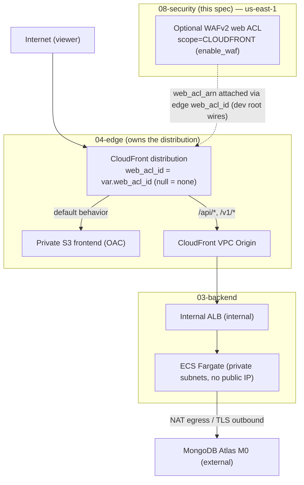
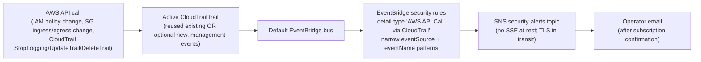
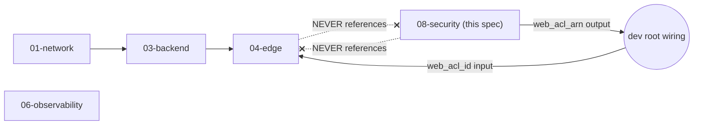

# Design Document

## Overview

This design describes a new reusable security module at
`ecs-terraform/modules/security/`, composed by the Terraform root module at
`ecs-terraform/envs/dev/`. The `Security_Module` adds a cross-cutting, cost-optimized security baseline
over the already-deployed development architecture. Every billable control it owns is **optional and
defaults OFF**, so the DEV baseline creates **zero** billable security resources until an operator
explicitly enables one (R1, R3.1, R8.4, R9.1, R14.3, R14.4).

**Scope of the "$0 baseline" claim.** The "$0 baseline" refers **only** to the **additional** resources
owned by this Security module when all of its feature toggles — `enable_waf`, `enable_cloudtrail`,
`enable_security_alerts`, and the detective toggles (`enable_guardduty`, `enable_config`,
`enable_security_hub`, `enable_inspector_enhanced`) — are disabled. It does **not** claim the overall DEV
environment is free. The existing network, backend, edge, and observability resources retain their own
costs (for example the NAT Gateway, ECR, and CloudWatch), and this module neither changes nor duplicates
them; those costs are unaffected by this module (R14.1–R14.4).

The module owns four independently toggled capabilities, each gated by its own boolean:

| Capability | Toggle (default) | What it creates when enabled | Requirements |
| --- | --- | --- | --- |
| **WAF** — request filtering at the CloudFront edge | `enable_waf` (`false`) | One WAFv2 `CLOUDFRONT` web ACL (Common Rule Set in count mode + one rate-based rule; extra managed groups off by default) | R2, R3, R4, R5, R6 |
| **CloudTrail** — management-event auditing | `enable_cloudtrail` (`false`) | One management-events-only trail + its backing S3 bucket, only when no suitable existing trail is reused | R8 |
| **EventBridge** — security-event detection | `enable_security_alerts` (`false`) | Narrow `aws_cloudwatch_event_rule` rules on the default bus matching IAM / security-group / CloudTrail-config changes | R9 |
| **SNS** — the notification path | `enable_security_alerts` (`false`) | One security-alerts topic + optional email subscription | R10 |

EventBridge and SNS share the single `enable_security_alerts` toggle because one is the detector and the
other is its delivery path; neither is useful without the other.

### Module file layout

The module organizes its configuration across the files required by R1.1, with no file left empty of
declarations (R1.2):

```
ecs-terraform/modules/security/
├── main.tf          # terraform {} required-providers block, locals { name_prefix },
│                    #   data.aws_caller_identity.current, shared account-scoping
├── waf.tf           # aws_wafv2_web_acl (count-gated, CLOUDFRONT scope)
├── cloudtrail.tf    # aws_cloudtrail + S3 bucket/BPA/SSE/policy/lifecycle (count-gated)
├── eventbridge.tf   # aws_cloudwatch_event_rule + aws_cloudwatch_event_target (count-gated)
├── sns.tf           # aws_sns_topic + policy + optional email subscription (count-gated)
├── variables.tf     # all typed, validated inputs
├── outputs.tf       # web_acl_arn (+ any consumed topic/trail outputs)
└── versions.tf      # optional; the terraform {} block may live in main.tf per convention
```

Following the established module convention (02-data / 03-backend / 04-edge), the `terraform {}`
required-providers block and the `locals { name_prefix }` block live at the top of `main.tf` rather than in
an organizational-only file; a separate `versions.tf` is listed by R1.1 and is created only if it carries
real declarations, otherwise the block stays in `main.tf` to avoid an empty file (R1.2). The module declares
**no** `backend` block and **no** `provider` block (R1.5, R2.5).

### Provider-compatibility conclusion (R13.4)

The dev root `versions.tf` pins `required_version = "~> 1.16.0"` and the AWS provider to `~> 6.67.0`; the
modules declare `aws` `>= 6.67.0, < 7.0.0`; the lock file resolves `hashicorp/aws` `6.67.0`. This resolved
version supports every resource this design uses: `aws_wafv2_web_acl` with `scope = "CLOUDFRONT"`,
`aws_cloudtrail`, `aws_cloudwatch_event_rule` / `aws_cloudwatch_event_target` (EventBridge), and
`aws_sns_topic` / `aws_sns_topic_policy` / `aws_sns_topic_subscription`. The design is therefore
provider-compatible, and the WAFv2-`CLOUDFRONT`-scope prerequisite is satisfied as long as the WAF
resources resolve through a `us-east-1` provider (Architecture → Providers, R2).

### Requirements addressed

This design maps to all 16 requirements in `requirements.md`, referenced inline as `(R<n>.<m>)`. It is
**DEV-only**: it creates no `envs/staging` or `envs/prod` and no staging/production resources (R16.6). This
spec is **design + consistency only** — it writes no Terraform, no `tasks.md`, runs no `terraform apply` or
`destroy`, creates no AWS resource, and changes no state. All work stays within `~/ecs-terraform-cicd`
(R13.7, R16.1, R16.3).

---

## Architecture

### Request path with the optional WAF at the edge (R3, R6)

CloudFront is the platform's only internet-facing resource, so the optional WAFv2 web ACL at that edge is
the primary application-layer request filter. The underlying request path is unchanged; WAF only adds an
inspection point in front of the existing distribution:



When `enable_waf = false` (DEV default), the security module creates zero WAFv2 resources and the
distribution's `web_acl_id` resolves to `null`, so the distribution is valid and has no web ACL association
(R3.2, R6.2, R6.5). The security module **never** creates a second distribution; exactly one
`aws_cloudfront_distribution` exists across the configuration, owned by the edge module (R6.3).

### Security-event flow (R8, R9, R10)

A separate, detective flow — independent of the request path — turns security-relevant API activity into an
operator email:



The EventBridge rules match only API activity that an **active** CloudTrail trail delivers to the default
bus. That trail is either a suitable **reused existing** account/organization trail or the module's
**optional new** trail (`enable_cloudtrail = true`). Without such a trail, the rules do not match any event
(R8.9, R9.6) — so the documentation states this dependency explicitly (R15.3), and an operator enabling
`enable_security_alerts` must also ensure a trail is active.

### Module dependency direction (no cycles) (R6.7, R15.1)



The attachment of the web ACL is wired **entirely by the dev root**: the security module exposes
`web_acl_arn`, and the dev root passes it into the edge module's new `web_acl_id` input. The security module
holds **no** reference to the edge module, and the edge module holds **no** reference to the security module.
The `network → backend → edge` direction is preserved because the only cross-link is dev-root wiring, which
does not create a module-to-module edge in either direction, so no circular dependency is introduced (R6.7,
R15.1). The security module sits beside observability as a cross-cutting consumer and is never referenced
back by network, backend, or edge.

### Providers (R2)

A WAFv2 `CLOUDFRONT`-scope web ACL must be created in `us-east-1`. The dev root currently declares only the
default-region provider. This design adds an aliased provider and maps it explicitly into the security
module:

```hcl
# envs/dev/providers.tf — ADD (default-region provider unchanged)
provider "aws" {
  alias  = "us_east_1"
  region = "us-east-1"

  # Identical default_tags to the default-region provider so every resource
  # created through this alias is tagged consistently (R2.6).
  default_tags {
    tags = {
      Project     = var.app_name
      Environment = var.environment
      ManagedBy   = "Terraform"
      Owner       = var.owner
    }
  }
}
```

The `module "security"` block receives this alias through `providers = { aws = aws.us_east_1 }` (R2.2). The
module declares no provider of its own and relies solely on the mapped provider (R2.5). The alias is
declared even while `enable_waf = false`, so enabling WAF later needs no additional provider wiring (R2.7).
Because the entire module resolves through the `us-east-1` provider, every WAF resource is created in
`us-east-1` whenever `enable_waf = true` (R2.3); if that provider resolved to any other region, a
`CLOUDFRONT`-scoped web ACL fails at plan/apply with AWS's region error and no web ACL is created (R2.4).

> **Note on the non-WAF resources.** CloudTrail, EventBridge default-bus rules, and SNS are region-scoped
> services. Mapping the whole module to `us-east-1` keeps the provider wiring simple and is consistent with
> the DEV region (`us-east-1`); all four capabilities therefore live in `us-east-1`. This keeps the single
> explicit provider mapping required by R2.2 and avoids a second alias.

---

## Components and Interfaces

### Security module input variables (`variables.tf`)

Every environment-specific value is a typed, described, validated input; the module embeds no DEV literal
(R1.4, R1.8). A variable declared without an explicit `type` would fail `terraform validate` naming the
offending variable (R1.8).

| Variable | Type | Default | Validation | Requirements |
| --- | --- | --- | --- | --- |
| `app_name` | string | — | non-empty / non-whitespace | R1.3 |
| `environment` | string | — | non-empty / non-whitespace | R1.3 |
| `tags` | map(string) | `{}` | — | R1.6 |
| `enable_waf` | bool | `false` | — | R3.1, R14.3 |
| `waf_default_action` | string | `"allow"` | one of `allow`, `block` | R3.4, R3.5 |
| `waf_rate_limit` | number | `2000` | integer `>= 100 && <= 2000000000` | R3.7, R3.11, R3.12, R14.6 |
| `waf_common_rule_set_mode` | string | `"Count_Mode"` | one of `Count_Mode`, `Block_Mode` | R4.1, R4.2, R4.4 |
| `waf_rate_based_rule_mode` | string | `"Count_Mode"` | one of `Count_Mode`, `Block_Mode` | R4.5 |
| `enable_known_bad_inputs` | bool | `false` | — | R3.8 |
| `waf_known_bad_inputs_mode` | string | `"Count_Mode"` | one of `Count_Mode`, `Block_Mode` | R3.8, R4.1, R4.2 |
| `enable_cloudtrail` | bool | `false` | — | R8.4, R14.3 |
| `reuse_existing_trail` | bool | `false` | — | R8.1, R8.6 |
| `cloudtrail_retention_days` | number | `365` | integer `>= 1 && <= 365` | R8.7 |
| `enable_security_alerts` | bool | `false` | — | R9.1, R14.3 |
| `security_alerts_email` | string | `""` | — (operational config, not a secret) | R10.2, R10.3, R10.4 |
| `enable_guardduty` | bool | `false` | — | R11.4, R14.3 |
| `enable_config` | bool | `false` | — | R11.4, R14.3 |
| `enable_security_hub` | bool | `false` | — | R11.4, R14.3 |
| `enable_inspector_enhanced` | bool | `false` | — | R11.4, R14.3 |

Notes:

- `waf_default_action`, each `*_mode`, and `waf_rate_limit` reject out-of-set / out-of-range values with a
  validation message naming the allowed values or range (R3.5, R3.12, R4.2, R4.5).
- The `*_mode` inputs let an operator move a rule from count to block **without editing module source**
  (R3.15, R4.4, R4.5). `Count_Mode` maps to a managed-rule-group `override_action { count {} }` (or a
  rate-rule `count {}` action); `Block_Mode` maps to `override_action { none {} }` (or the rate-rule `block
  {}` action), letting the managed group's / rule's own block action apply.
- `reuse_existing_trail` records the operator's reuse decision from R8.1's reuse-first check; when `true`,
  the module creates no trail even if `enable_cloudtrail` is `true` (the trail resource count becomes
  `enable_cloudtrail && !reuse_existing_trail`).
- `cloudtrail_retention_days` is capped at 365 so no trail object is retained indefinitely (R8.7).
- The optional detective-service toggles (`enable_guardduty`, `enable_config`, `enable_security_hub`,
  `enable_inspector_enhanced`) all default `false`; while every one retains its default, the module creates
  zero account-wide detective resources (R11.3, R11.4, R11.5, R14.3). The design keeps these as the gating
  surface only; the review (below) recommends they stay deferred for DEV (R11.7), and no CMK variable is
  introduced, so no CMK is created (R11.6, R14.8).

### Security module outputs (`outputs.tf`)

The surface is minimal — only values a downstream consumer needs (R1.7 non-hardcoding, minimal-outputs
convention):

| Output | Value | Notes |
| --- | --- | --- |
| `web_acl_arn` | `var.enable_waf ? one(aws_wafv2_web_acl.this[*].arn) : null` | Consumed by the dev root to wire the edge `web_acl_id`. Non-empty `arn:` string when WAF enabled (R6.1); `null` when disabled (R6.2). `one(...)` yields a clean scalar/`null` without indexing a zero-count resource |
| `security_alerts_topic_arn` | `one(aws_sns_topic.security_alerts[*].arn)` | `null` when `enable_security_alerts = false`; used by operators to confirm the topic / subscribe. No secret value |
| `cloudtrail_bucket_name` | `one(aws_s3_bucket.trail[*].bucket)` | `null` unless a new trail is created; lets operators locate the log bucket |

No output is or derives from a secret value (R15 documentation / least-privilege).

### New edge input and dev-root wiring (R6)

The edge module gains exactly one optional input; its distribution sets `web_acl_id` from it. Nothing else
in the edge module changes:

```hcl
# modules/edge/variables.tf — ADD
variable "web_acl_id" {
  description = "ARN of a WAFv2 CLOUDFRONT-scope web ACL to associate with the distribution; null (default) leaves the distribution with no web ACL association."
  type        = string
  default     = null
}
```

```hcl
# modules/edge/cloudfront.tf — resource aws_cloudfront_distribution.this, ADD one line
resource "aws_cloudfront_distribution" "this" {
  # ...unchanged...
  web_acl_id = var.web_acl_id   # null => no association; a valid, deployable distribution (R6.5, R6.6)
}
```

The dev root composes the module and wires the output into the edge input through module references only
(R6.7):

```hcl
# envs/dev/main.tf — ADD
module "security" {
  source    = "../../modules/security"
  providers = { aws = aws.us_east_1 }   # R2.2 — CLOUDFRONT-scope WAF in us-east-1

  app_name    = var.app_name
  environment = var.environment
  tags = {
    Project     = var.app_name
    Environment = var.environment
    ManagedBy   = "Terraform"
    Owner       = var.owner
  }

  enable_waf             = var.enable_waf             # DEV: false
  enable_cloudtrail      = var.enable_cloudtrail      # DEV: false
  enable_security_alerts = var.enable_security_alerts # DEV: false
  security_alerts_email  = var.security_alerts_email  # DEV: ""
  # WAF tuning / detective-service toggles use module defaults in DEV.
}

# edge now receives the optional web ACL ARN (null while enable_waf = false).
module "edge" {
  # ...existing inputs unchanged...
  web_acl_id = module.security.web_acl_arn   # R6.6, R6.7
}
```

`envs/dev/variables.tf` declares each root input (`enable_waf`, `enable_cloudtrail`,
`enable_security_alerts`, `security_alerts_email`) with explicit type and description;
`envs/dev/terraform.tfvars` sets the DEV values (all toggles `false`, email `""`). No secret is placed in
`terraform.tfvars` (R13.6, R16.5).

---

## Components and resources per file

### `main.tf` — shared locals, naming, account identity

```hcl
terraform {
  required_version = "~> 1.16.0"
  required_providers {
    aws = { source = "hashicorp/aws", version = ">= 6.67.0, < 7.0.0" }   # R1.5
  }
}

locals {
  name_prefix = "${var.app_name}-${var.environment}"   # R1.3 — stated once
}

# Account id for topic-policy SourceAccount scoping — no hardcoded account id (R7, R10.5)
data "aws_caller_identity" "current" {}
```

`local.name_prefix` is the single source of every resource name and metric name; the
`"${app_name}-${environment}"` expression appears in exactly one place (R1.3). No AWS account id, ARN,
CloudFront distribution id, or managed-policy id is a hardcoded literal — each comes from a variable, a data
source, a reference, or a module output (R1.7).

### `waf.tf` — optional WAFv2 web ACL (R3, R4, R5)

A single count-gated `aws_wafv2_web_acl.this` with `count = var.enable_waf ? 1 : 0`, created through the
mapped `us-east-1` provider:

- `scope = "CLOUDFRONT"` (R3.3); `name` and `metric_name` derived from `local.name_prefix` (R3.14, R5.3).
- `default_action` from `var.waf_default_action` (`allow` | `block`, default `allow`) (R3.4, R3.5).

**Initial (as-delivered) actions are COUNT (R3.6, R3.7, R4.1, R4.3, R4.4, R4.5).** In its initial
configuration the web ACL inspects and **counts** but blocks **nothing**: both the AWS Managed Common Rule
Set managed-rule-group override **and** the rate-based rule action default to COUNT, because
`var.waf_common_rule_set_mode` and `var.waf_rate_based_rule_mode` both default to `"Count_Mode"`. The only
non-count disposition in the as-delivered ACL is the `default_action`, which remains `allow` — so an
unmatched request is allowed, and a matched request is counted and labeled, never blocked. The explicit
mode→action mapping for every managed rule group and for the rate rule is:

| `*_mode` value | Managed-rule-group override | Rate-based-rule action |
| --- | --- | --- |
| `Count_Mode` (default) | `override_action { count {} }` | `action { count {} }` |
| `Block_Mode` | `override_action { none {} }` (managed group's own block actions apply) | `action { block {} }` |

- **Rule 1 — Common Rule Set** (`priority = 1`): managed rule statement
  `managed_rule_group_statement { name = "AWSManagedRulesCommonRuleSet", vendor_name = "AWS" }` with
  `override_action` derived from `var.waf_common_rule_set_mode` — `override_action { count {} }` for
  `Count_Mode` (the default, so the group counts and never blocks as delivered), `override_action { none {} }`
  for `Block_Mode` so the managed group's own actions apply. This forms the cost-optimized baseline with the
  rate rule (R3.6, R4.1, R4.3).
- **Rule 2 — Rate-based rule** (`priority = 2`): exactly one `rate_based_statement` with
  `limit = var.waf_rate_limit`, `aggregate_key_type = "IP"`, over WAFv2's fixed 300-second window; action is
  `action { count {} }` (the default from `waf_rate_based_rule_mode = "Count_Mode"`, so the rate rule counts
  and never blocks as delivered) or `action { block {} }` when `var.waf_rate_based_rule_mode = "Block_Mode"`
  (R3.7, R3.11, R4.5).
- **Rule 3 — Known-Bad-Inputs (optional)** (`priority = 3`): created only when
  `var.enable_known_bad_inputs = true`, using
  `managed_rule_group_statement { name = "AWSManagedRulesKnownBadInputsRuleSet" }` with `override_action`
  from `var.waf_known_bad_inputs_mode` (default count). Any additional managed group would follow the same
  pattern, each behind its own toggle so the baseline stays Common + rate rule (R3.8).
- **Priorities** are distinct integers increasing in ascending order (1, 2, 3…) with no collisions (R3.13).
- **Visibility** — the ACL and every rule set `visibility_config { cloudwatch_metrics_enabled = true,
  sampled_requests_enabled = true, metric_name = "<name_prefix>-<rule>" }`. Each metric name begins with
  `name_prefix`, is unique across rules, ≤ 128 chars, and uses only alphanumeric/hyphen/underscore (R5.1,
  R5.2, R5.4, R5.5). If `name_prefix` were empty/null while `enable_waf = true`, name derivation fails
  validation naming `name_prefix` and no web ACL is created (R5.6).
- **Excluded by design:** no premium/paid managed group, no Bot Control, no CAPTCHA, no Challenge actions
  (R3.9), and **no** `aws_wafv2_web_acl_logging_configuration` (R3.10).

**Count → Block transition and false-positive evaluation (R4.3, R4.4, R4.5, R4.6, R15.6).** As delivered,
every rule is in `Count_Mode` (`override_action { count {} }` for the managed group, `action { count {} }`
for the rate rule), so matched requests are counted and labeled but never blocked (R4.3). To transition a
rule to BLOCK, operators evaluate false positives over a **defined observation window (for example, 7 days
of DEV traffic)** using the per-rule CloudWatch metrics, the sampled-request view, and the WAF labels
emitted while counting. Only after **zero false-positive matches are observed over that window** do they
flip the specific `*_mode` input to `Block_Mode` — which changes the managed group to
`override_action { none {} }` or the rate rule to `action { block {} }` — by changing only the input value,
with no module edit (R4.4, R4.5, R3.15). The documentation lists each WAF rule, its starting mode (all start
`Count_Mode`), which rules are intended to move to `Block_Mode`, and this measurable zero-false-positive
observation-window condition (R15.6).

### `cloudtrail.tf` — reuse-first, optional management trail (R8)

**Reuse-first strategy (R8.1, R8.2).** Before any trail is created, the operator checks whether a suitable
existing account or organization trail already covers management events for the target account/region.
Terraform data sources cannot reliably enumerate "any suitable trail," so the check is an **operator step**
documented in the spec. A trail counts as **suitable for reuse only when BOTH of the following hold**:

1. **Configuration coverage** — a multi-region trail that includes management events for the target
   account/region, verified with `aws cloudtrail describe-trails` (inspecting `IsMultiRegionTrail` and the
   trail's management-event / event-selector configuration).
2. **Active logging status** — the trail is actively logging, verified with
   `aws cloudtrail get-trail-status`, where the returned `IsLogging` flag is `true`.

A trail that is **configured but stopped** (`IsLogging = false`) is **NOT** suitable for reuse: it does not
deliver API-call events and therefore does **not** satisfy the EventBridge dependency, even though its
configuration looks complete. If — and only if — a trail satisfies **both** the coverage and the
`IsLogging = true` checks, the operator sets `reuse_existing_trail = true` and the module creates **no**
trail, avoiding a duplicate name/configuration (R8.1, R8.2). Otherwise the operator leaves
`reuse_existing_trail = false` and enables `enable_cloudtrail` to create the new trail. The documentation
also states that CloudTrail **Event History** covers the last 90 days of management events with no
configured trail, but retains only 90 days, excludes data events, and does not deliver to a durable S3
bucket (R8.3).

**Creation (gated by `enable_cloudtrail && !reuse_existing_trail`).** When a new trail is created:

- `aws_cloudtrail.this` — **management events only**, `enable_log_file_validation = true` (R8.6);
  `include_management_events = true`, `read_write_type = "All"`; **no** data-event selectors, **no**
  CloudTrail Lake, **no** CloudWatch Logs delivery (R8.8).
- `aws_s3_bucket.trail` — backing bucket, named from `name_prefix`.
- `aws_s3_bucket_public_access_block.trail` — all four settings `true` (R8.6).
- `aws_s3_bucket_server_side_encryption_configuration.trail` — SSE-S3 (`AES256`, AWS-managed); **no CMK**
  (R8.6, R11.6, R14.8).
- `aws_s3_bucket_policy.trail` — the **required** CloudTrail service bucket policy. Without this bucket
  policy CloudTrail cannot deliver log files to the bucket, so a new trail always creates it. It allows the
  `cloudtrail.amazonaws.com` service principal:
  - `s3:GetBucketAcl` on the bucket ARN, and
  - `s3:PutObject` on the `AWSLogs/<account-id>/*` prefix, where `<account-id>` comes from
    `data.aws_caller_identity.current.account_id` (no hardcoded account id), guarded by a
    `StringEquals` condition on `s3:x-amz-acl = "bucket-owner-full-control"`.

  Both statements are additionally scoped by `aws:SourceArn` (the trail ARN) and `aws:SourceAccount` (the
  current account), sourced via `data.aws_caller_identity.current` so no account id, bucket ARN, or trail
  ARN is a hardcoded literal (R1.7, R8.1, R8.2, R8.6, R8.9).
- `aws_s3_bucket_lifecycle_configuration.trail` — expires trail objects after
  `var.cloudtrail_retention_days` (≤ 365), so nothing is retained indefinitely (R8.7).

**EventBridge dependency.** A reused or newly created active trail is what delivers API-call events to the
default bus; without it the EventBridge rules match nothing (R8.9, R9.6) — reiterated in eventbridge.tf and
in the documentation (R15.3).

### `eventbridge.tf` — targeted security-event rules (R9)

Count-gated by `enable_security_alerts`. Each rule is a narrow `aws_cloudwatch_event_rule` on the **default**
event bus with `detail-type = "AWS API Call via CloudTrail"` and a specific `detail.eventSource` +
`detail.eventName` pattern — never a catch-all (R9.3, R9.4). Every `eventName` below is a **valid
CloudTrail-recorded API action** paired with its correct `eventSource`:

| Rule | `detail.eventSource` | `detail.eventName` (valid CloudTrail actions) |
| --- | --- | --- |
| IAM policy changes | `iam.amazonaws.com` | `PutUserPolicy`, `PutGroupPolicy`, `PutRolePolicy`, `AttachUserPolicy`, `AttachGroupPolicy`, `AttachRolePolicy`, `DetachUserPolicy`, `DetachGroupPolicy`, `DetachRolePolicy`, `CreatePolicy`, `DeletePolicy`, `CreatePolicyVersion`, `DeletePolicyVersion` |
| Security-group ingress/egress changes | `ec2.amazonaws.com` | `AuthorizeSecurityGroupIngress`, `AuthorizeSecurityGroupEgress`, `RevokeSecurityGroupIngress`, `RevokeSecurityGroupEgress` |
| CloudTrail config changes | `cloudtrail.amazonaws.com` | `StopLogging`, `UpdateTrail`, `DeleteTrail` |

Each pattern uses `detail-type = "AWS API Call via CloudTrail"` with the `detail.eventSource` and
`detail.eventName` keys shown above, so the rule matches only those specific API actions from that one
service (R9.3, R9.4). Each rule has a matching `aws_cloudwatch_event_target` whose `arn` is the SNS
security-alerts topic (R9.5). The module creates **no** Lambda or other custom event-processing service
(R9.7).

**SNS-side hard dependency (cross-reference to `sns.tf`).** For an EventBridge→SNS target to actually
deliver, the SNS topic policy **must** grant the `events.amazonaws.com` principal `SNS:Publish` on the topic
(scoped by `aws:SourceAccount`). That topic policy — declared in `sns.tf` as
`aws_sns_topic_policy.security_alerts` — is therefore a **hard dependency** of every EventBridge target
here: without it, EventBridge cannot publish and no notification is delivered even though the rule matches.
The two sections are linked and must stay consistent (see `sns.tf`) (R9.5, R10.5).

**Active-trail dependency.** As with CloudTrail, these rules only match when a **suitable ACTIVE** trail
delivers the API-call events to the default bus — either a **reused existing** trail with `IsLogging = true`
**or** the module's **enabled new** trail (`enable_cloudtrail = true`). Without such an active trail, no
API-call events reach the default bus and the rules **never match** (R8.9, R9.6).

### `sns.tf` — security-alerts topic (R10)

Mirrors the observability SNS convention, count-gated by `enable_security_alerts`:

- `aws_sns_topic.security_alerts` — `count = var.enable_security_alerts ? 1 : 0`, named
  `"${local.name_prefix}-security-alerts"` (R10.1). **No** server-side encryption at rest: the AWS-managed
  `alias/aws/sns` key cannot be used for a service (EventBridge) to publish to an encrypted topic because its
  key policy can't be modified to grant the service `kms:GenerateDataKey`/`kms:Decrypt`, so encrypted
  delivery would fail; TLS protects data in transit and the payloads carry only event text (no PII, answers,
  or secrets). A CMK path is deferred (R10.7, R14.8). The documentation records this at-rest choice and notes
  the publishing principal here is **EventBridge** (`events.amazonaws.com`), not CloudWatch (R10.7).
- `aws_sns_topic_policy.security_alerts` from an `aws_iam_policy_document` allowing
  `events.amazonaws.com` to `SNS:Publish` on this topic, scoped by an `aws:SourceAccount` condition sourced
  from `data.aws_caller_identity.current` — no hardcoded account id (R10.5). This topic policy is a **hard
  dependency of the EventBridge targets** declared in `eventbridge.tf`: EventBridge→SNS delivery works only
  because this policy grants the `events.amazonaws.com` principal publish rights, so the policy is present
  whenever the topic is, and the two sections must stay consistent (R9.5, R10.5).
- `aws_sns_topic_subscription.security_alerts_email` — `count = var.enable_security_alerts &&
  trimspace(var.security_alerts_email) != "" ? 1 : 0`, protocol `email`, endpoint `var.security_alerts_email`
  (R10.3). When enabled with an empty email, the topic exists with no subscription (R10.4). No Lambda/custom
  processor handles published messages (R10.6).
- **Email confirmation (R10.8, R15.4).** An email subscription stays `PendingConfirmation` until the
  recipient clicks the confirmation link AWS emails them; notifications are not delivered until confirmed.
  The documentation describes this step.

### `variables.tf`, `outputs.tf`, `versions.tf` roles

- `variables.tf` — all typed, described (1–1024 chars), validated inputs from the interface table (R1.4,
  R1.8).
- `outputs.tf` — the minimal consumed outputs (`web_acl_arn`, `security_alerts_topic_arn`,
  `cloudtrail_bucket_name`), each using `one(...)` for a clean `null` when its feature is off.
- `versions.tf` — listed by R1.1; created only if it carries the `terraform {}` block. Per module
  convention the block lives in `main.tf`, so `versions.tf` is either that real block relocated or omitted to
  avoid an empty file (R1.2). This design keeps the block in `main.tf`.

---

## Data Models

The security module manipulates no application data; its "data models" are the Terraform resource shapes
and the count-gating locals. The governing invariants:

- **Toggle gating.** Each capability's resource count is `toggle ? 1 : 0` (WAF, SNS, EventBridge rules) or
  `enable_cloudtrail && !reuse_existing_trail ? 1 : 0` (trail). With all toggles `false`, every count is `0`.
- **Null-safe outputs.** Outputs use `one(resource[*].attr)`, which yields the single value when count is 1
  and `null` when count is 0 — so `web_acl_arn` is `null` while WAF is disabled and the edge `web_acl_id`
  receives `null`, leaving the distribution association-free (R6.2, R6.5).
- **Mode mapping.** `Count_Mode` ⇒ managed-group `override_action { count {} }` / rate-rule `count {}`;
  `Block_Mode` ⇒ `override_action { none {} }` / rate-rule `block {}`.
- **Naming.** Every resource `Name` tag and WAF metric name derives from `local.name_prefix`, merged via
  `merge(var.tags, { Name = ... })` (R1.6, R3.14, R5.3).

### Preserved bootstrap / architecture facts (R16.5)

This design **preserves all existing Terraform architecture** — network, backend, edge, and observability —
and the only change any existing module receives is the **additive, optional** `web_acl_id` input on the
edge module (default `null`), which leaves the distribution unchanged when WAF is off. It likewise
preserves the MongoDB settings (the Secrets Manager ARN references `app_secret_arn` and
`staff_admin_secret_arn`, and the database names `teacher_student_db` and `admin_staff_mongodb`), the ECS
bootstrap configuration (`image_tag = "latest"`, `desired_count = 0`, `min_capacity = 0`), and the NAT
Gateway configuration — all **unchanged and not duplicated** by this module. The table below records each
preserved fact; this spec changes none of them, and they remain owned by their existing modules:

| Preserved item | Owner | This spec |
| --- | --- | --- |
| MongoDB secret ARNs `app_secret_arn`, `staff_admin_secret_arn` | backend / dev root | unchanged |
| DB names `teacher_student_db`, `admin_staff_mongodb` | dev root tfvars | unchanged |
| ECS `image_tag = latest`, `desired_count = 0`, `min_capacity = 0` | backend / dev root | unchanged |
| NAT Gateway configuration | network | unchanged |
| network / backend / edge / observability architecture | respective modules | unchanged (edge gains only the optional `web_acl_id` input) |
| ECR `scan_on_push = true` (basic scanning) | backend | reviewed & retained, not duplicated (R7) |

---

## Error Handling

- **Validation-time rejection.** An out-of-set `waf_default_action` or `*_mode`, an out-of-range
  `waf_rate_limit` or `cloudtrail_retention_days`, or a variable missing its `type` fails `terraform
  validate` with a message naming the offending variable and its allowed values/range (R1.8, R3.5, R3.12,
  R4.2, R4.5, R8.7).
- **Wrong region for WAF.** If the mapped provider resolves to a non-`us-east-1` region while
  `enable_waf = true`, the `CLOUDFRONT`-scoped web ACL fails at plan/apply with AWS's region error and no web
  ACL is created (R2.4).
- **Empty name prefix.** An empty/null `name_prefix` while `enable_waf = true` fails WAF metric-name
  derivation, naming `name_prefix`, and no web ACL is created (R5.6).
- **Toggles off.** With every toggle `false`, all counts are `0`; `web_acl_arn`,
  `security_alerts_topic_arn`, and `cloudtrail_bucket_name` resolve to `null` without a Terraform error, and
  the edge distribution has no web ACL association (R3.2, R6.2, R8.5, R9.2).
- **Missing trail.** When `enable_security_alerts = true` but no active trail exists, the EventBridge rules
  simply match nothing; this is expected behavior, documented as the CloudTrail dependency rather than a
  Terraform error (R8.9, R9.6).

---

## Cost Model

All figures are **approximate `us-east-1` public-pricing planning estimates, not a quote**; AWS pricing may
change. The decisive fact is that all three billable toggles default **OFF**, so the DEV baseline cost of
this module is **$0** (R14.1, R14.2, R14.3, R14.4).

**What "$0 baseline" means (and does not mean).** This "$0 baseline" is scoped to the **additional**
resources owned by this Security module when all of its feature toggles — `enable_waf`,
`enable_cloudtrail`, `enable_security_alerts`, and the detective toggles (`enable_guardduty`,
`enable_config`, `enable_security_hub`, `enable_inspector_enhanced`) — are disabled. It does **not** claim
the overall DEV environment is free. Existing network, backend, edge, and observability resources keep
their own costs (for example the NAT Gateway, ECR, and CloudWatch log storage), and this module neither
modifies nor duplicates them, so those costs are unchanged by this module (R14.1–R14.4).

| Capability | Cost dimension(s) | Approx. DEV monthly estimate (low traffic) | Varies with |
| --- | --- | --- | --- |
| **WAFv2 web ACL** (only if `enable_waf`) | ~$5 per web ACL + ~$1 per active rule + ~$0.60 per million requests | ~$5 + ~$2–3 (2–3 rules) + near-$0 requests ≈ **$7–8** when enabled | **Request volume** (per-million) and rule count |
| **CloudTrail** (only if `enable_cloudtrail` & new trail) | First copy of management events is **free**; S3 storage for delivered log files | near-$0 (management events free; a few cents of S3 at low volume) | **Logging / storage volume** (S3) |
| **EventBridge** (only if `enable_security_alerts`) | AWS service / CloudTrail-delivered API-call events on the **default** bus are **free** to match; targets/SNS delivery incur downstream cost | near-$0 for matching; cost is the SNS delivery | **Event volume** (effectively free on default bus) |
| **SNS** (only if `enable_security_alerts`) | Email notifications: first 1,000/month **free**, then nominal | near-$0 at DEV alert volume | **Notification volume** |
| Detective services (GuardDuty/Config/Security Hub/Inspector) | all **OFF**; deferred | **$0** | n/a (see review) |

Cost-dimension classification required by R14.2: WAF cost varies with **request volume** (per-million) plus
per-ACL/per-rule; CloudTrail S3 cost varies with **logging/storage volume**; EventBridge cost (default-bus
AWS events) is effectively free and varies with event volume only via downstream targets; SNS cost varies
with **notification volume**. The documentation states the module prepares configuration only and deploys no
billable resource, distinguishing preparing config from deploying it (R14.5).

---

## Security Considerations

- **Least privilege.** The SNS topic policy allows exactly one action (`SNS:Publish`) for exactly one
  service principal (`events.amazonaws.com`), scoped to this account via `aws:SourceAccount` from
  `data.aws_caller_identity.current` — no wildcard principal, no cross-account access (R10.5). EventBridge
  patterns are narrow (`eventSource` + `eventName`), never a catch-all (R9.4).
- **Private-by-default preserved; no public exposure introduced.** The module adds no public endpoint, no
  public IP, and no internet-facing resource. The only edge change is attaching an optional web ACL to the
  **existing** CloudFront distribution — tightening, not opening, the edge. The internal ALB stays internal,
  ECS tasks stay private with no public IP, and the frontend S3 bucket stays private behind OAC; the security
  review confirms each (R12.5).
- **Encryption decisions.** The trail bucket uses SSE-S3 (`AES256`, AWS-managed) with BPA on all four
  settings (R8.6); **no CMK** is created (R11.6, R14.8); the SNS topic uses TLS in transit with no SSE at
  rest for the documented service-publish reason (R10.7). The trail enables log-file validation for
  tamper-evidence (R8.6).
- **Reuse without duplication.** Existing controls are reused as-is and not re-created: backend IAM roles
  (ECS execution/task), security groups, Secrets Manager references, ECR basic scanning (`scan_on_push`),
  S3 block-public-access, and the observability CloudWatch monitoring (R7, R14.7). This spec modifies none of
  them unless the security review records a `VERIFIED_DEFECT` justifying the change (R12.4).
- **Review, not changes (R11, R12).** The security-architecture review produces written findings — classified
  `VERIFIED_DEFECT` or `OPTIONAL_IMPROVEMENT` — across the required review areas, confirms ECS-private /
  ALB-internal / S3-private-behind-OAC / no-public-exposure, and confirms the preserved bootstrap values are
  `UNCHANGED`. It evaluates GuardDuty, Config, Security Hub, Inspector enhanced scanning, and CMK (risk
  addressed, already-implemented, recommended-for-DEV, estimated monthly cost, deferred), recommending each
  stays deferred for DEV absent a stated justification (R11.1, R11.7, R12).

---

## Testing Strategy

This feature is **declarative Terraform Infrastructure-as-Code** — a WAFv2 web ACL, a CloudTrail trail and
its S3 bucket, EventBridge rules, and an SNS topic, plus an additive edge input and dev-root provider/wiring.
There is no runtime algorithm or data transformation whose behavior varies with generated input, so
**property-based testing does not apply**; the Correctness Properties section is intentionally omitted.
Verification is the Terraform workflow plus plan inspection, with **no `apply` and no `destroy`** (R13):

- **Init note (R13.8).** Before any `terraform init` that downloads providers, state that initialization
  downloads providers (a network-dependent action) so it is understood before execution.
- **Formatting (R13.1).** `terraform fmt -recursive` from `ecs-terraform/envs/dev`, then
  `terraform fmt -check -recursive` exits `0` with zero files needing formatting.
- **Validation (R13.2, R13.3).** `terraform validate` from the dev root exits `0` after the module is wired;
  a bad numeric/enum input or a type-less variable fails validation naming the variable, and every error is
  resolved and re-validated before planning.
- **Provider / region check for WAF (R13.4).** Confirm the resolved AWS provider satisfies
  `>= 6.67.0, < 7.0.0` (lock resolves `6.67.0`) and supports WAFv2 `CLOUDFRONT` scope through the
  `us-east-1` alias before relying on WAF; halt and report if incompatible.
- **Plan — default DEV (all toggles off).** `terraform plan` shows **zero** security resources: no
  `aws_wafv2_web_acl`, no `aws_cloudtrail` / trail bucket, no `aws_cloudwatch_event_rule` /
  `aws_cloudwatch_event_target`, no `aws_sns_topic`; `web_acl_arn` plans as `null` and the distribution has
  no web ACL association.
- **Plan — toggles on.** With `enable_waf = true`, plan shows exactly one web ACL (Common Rule Set in count +
  one rate rule; extra groups only if their toggle is on) with per-rule visibility config; with
  `enable_cloudtrail = true` (and no reuse), one trail + one bucket with BPA/SSE/policy/lifecycle; with
  `enable_security_alerts = true`, the EventBridge rules + targets and one SNS topic (+ email subscription
  when a non-empty email is supplied).
- **Non-duplication (R13.5).** Plan confirms exactly one `aws_cloudfront_distribution` (edge-owned), one ECR
  `image_scanning_configuration` (backend-owned), and that the module duplicates no network/backend/edge/
  observability resource; any duplicate is reported and planning halts.
- **Secret scan (R13.6).** Review the git diff of all tracked files to confirm no AWS keys, connection URIs,
  tokens, passwords, or private keys are introduced; report the file and halt if any is found.
- **Scope (R13.7, R16).** No `apply`/`destroy`, no overwrite of `tfplan-dev`, changes confined to
  `~/ecs-terraform-cicd`, no git branch/commit/push operations, no `envs/staging` or `envs/prod`.

Any resulting plan is additionally reviewed for unexpected destruction/replacement, unintended public
exposure, security-group or IAM changes, missing/indefinite retention, and resources outside DEV scope
before any later apply decision. This spec runs no `apply`, creates no AWS resources, and modifies no state.

---

## Future Production Hardening

Deferred for DEV and recorded for a future, explicitly requested environment (R15.8):

- **Move WAF to blocking.** After false-positive evaluation (zero false positives over the defined
  observation window), flip the Common Rule Set, the rate-based rule, and any enabled managed group from
  `Count_Mode` to `Block_Mode` via the `*_mode` inputs — no module edit (R4.4, R4.5, R15.6).
- **Custom domain at the edge.** Add a custom viewer domain, a Route 53 hosted zone/records, and a custom
  ACM certificate in `us-east-1` (via the now-available `aws.us_east_1` alias) in the edge module — none
  created for DEV.
- **Enable deferred detective services.** Turn on GuardDuty, AWS Config, Security Hub, and/or Inspector
  enhanced scanning behind their existing toggles, each with its stated recurring-cost note from the review
  (R11).
- **Customer-managed KMS + encrypted SNS.** Introduce a CMK (with an explicit key policy granting the
  EventBridge principal `kms:GenerateDataKey`/`kms:Decrypt`) to encrypt the SNS topic at rest, replacing the
  TLS-in-transit-only DEV posture (R10.7, R14.8).
- **Widen / stage CloudTrail.** Expand beyond management-events-only (data events, longer retention, or
  CloudWatch Logs delivery) when justified and approved (R8.8).
- **WAF logging.** Add `aws_wafv2_web_acl_logging_configuration` to a dedicated destination if request-level
  forensics are later required — intentionally absent in DEV (R3.10).
```