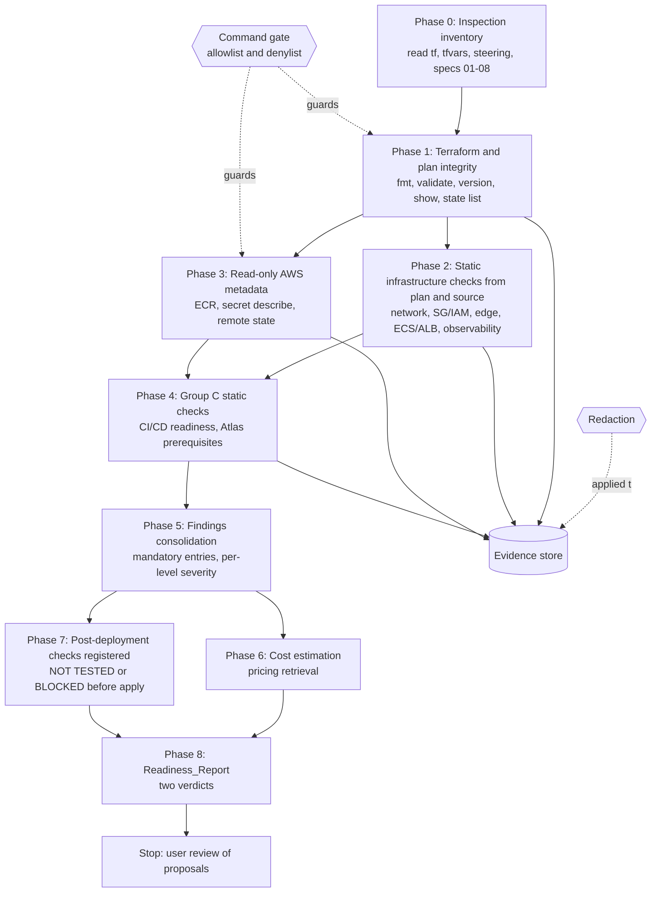
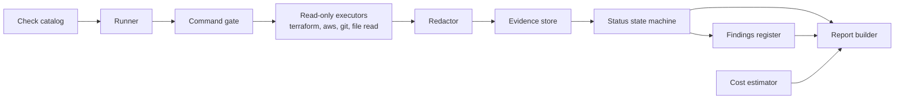
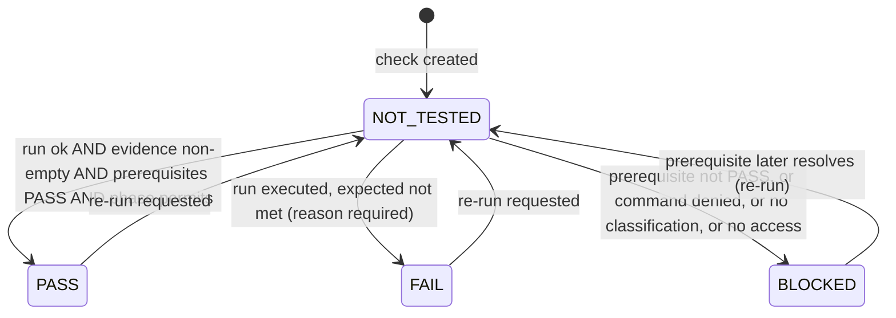

# Design Document

## Overview

This design describes a read-only validation framework for the Erudition Solution DEV environment (`ecs-terraform/envs/dev/`, AWS `us-east-1`). It is not an infrastructure change. The framework inspects the Terraform sources, the saved plan, remote state metadata, Git, and read-only AWS metadata, and records every result as a Check with a Status and Evidence. It consolidates deviations into a Findings register and produces a Readiness_Report with two verdicts: Bootstrap_Readiness and Application_Deployment_Readiness.

### Scope

In scope:

- Read-only inspection of `.tf`/`.tfvars` files in `ecs-terraform/envs/dev/` and `ecs-terraform/modules/{network,backend,edge,observability,security,cicd}`, `.kiro/steering/*.md`, and specs 01 to 08.
- Read-only Terraform commands, read-only AWS Describe/Get/List calls, and read-only Git commands.
- Evidence capture with redaction, a check catalog, a findings register, cost estimation, and the Readiness_Report.

Out of scope (enforced by the allowlist and denylist below):

- Any change to Terraform files, tfvars, Jenkins, state, or AWS resources. Fixes are only proposals with approval status `AWAITING_APPROVAL`.
- Creating `envs/staging` or `envs/prod`, and creating `tasks.md` (a later phase of the spec workflow).

### Repository facts the design references (observed read-only, re-verified by the checks)

| Item | Observed location or name |
|---|---|
| Dev root files | `backend.tf` (empty `backend "s3" {}`), `main.tf`, `outputs.tf`, `providers.tf`, `variables.tf`, `versions.tf`, `terraform.tfvars`, `.terraform.lock.hcl` |
| Saved plan files | `envs/dev/tfplan-dev` (binary, source of truth), `tfplan-dev.json`, `tfplan-dev-formatted.json` (renderings, not trusted). Measured on 2026-11-02: binary plan modified 11:21, JSON renderings 10:03 and 10:04, so both renderings are older than the binary plan (stale) |
| Dev root outputs | `vpc_id`, `public_subnet_ids`, `private_subnet_ids`, `nat_gateway_id`, `nat_public_ip`, `ecr_repository_url`, `alb_dns_name`, `ecs_cluster_name`, `ecs_service_name`, `cloudfront_domain_name`, `cloudfront_distribution_id`, `frontend_bucket_name`, `observability_dashboard_name`, `observability_sns_topic_arn` |
| Dev root variables | `app_name`, `environment`, `aws_region`, `owner`, `vpc_cidr`, `public_subnet_cidr1/2`, `private_subnet_cidr1/2`, `enable_nat_gateway`, `enable_vpc_endpoints`, `app_secret_arn`, `db_name`, `staff_admin_secret_arn`, `staff_admin_db_name`, `container_port`, `health_check_path`, `image_tag`, `desired_count`, `min_capacity`, `log_retention_days`, `enable_observability_sns`, `observability_sns_email`, `image_tag_mutability`, `enable_waf`, `enable_cloudtrail`, `enable_security_alerts`, `security_alerts_email` |
| Module files (backend) | `alb.tf`, `autoscaling.tf`, `ecr.tf`, `ecs.tf`, `iam.tf`, `locals.tf`, `logs.tf`, `outputs.tf`, `secrets.tf`, `variables.tf` |
| Module files (edge) | `cloudfront.tf` (uncommitted change per `git status`), `s3.tf`, `locals.tf`, `outputs.tf`, `variables.tf` |
| Module files (network) | `vpc.tf`, `public_subnet.tf`, `private_subnet.tf`, `igw.tf`, `natgw.tf`, `endpoints.tf`, `public_route_table.tf`, `private_route_table.tf`, `data.tf`, `locals.tf`, `outputs.tf`, `versions.tf`, `variables.tf` |
| Module files (observability / security) | `cloudwatch_alarms.tf`, `dashboard.tf`, `sns.tf` / `waf.tf`, `cloudtrail.tf`, `eventbridge.tf`, `sns.tf`, `main.tf` |
| Backend module outputs consumed downstream | `alb_arn`, `alb_dns_name`, `alb_arn_suffix`, `target_group_arn_suffix`, `ecs_log_group_name` |
| `modules/cicd/` | contains no files |
| Jenkinsfile | none found by repository file search |
| Ignore rules | root `.gitignore`: `tfplan-*`, `*.tfplan.json`, `plan.json`, `*.tfstate`, `*.tfstate.*`, `*.tfvars`, `backend.config`, `**/.terraform/` |
| `lifecycle.ignore_changes` in `modules/backend/*.tf` | no match found by grep (supports the desired_count drift finding, verified again by CHK-ECS-009) |
| Local state-format files | Three exist, all git-ignored (`*.tfstate`, `*.tfstate.*`) and untracked. Repo-root `terraform.tfstate` and `ecs-terraform/modules/terraform.tfstate` are 181-byte empty state shells (format version 4, Terraform 1.16.4, serial 1, zero resources, zero outputs, created 2026-09-29), consistent with Terraform having been run from a directory without the S3 backend configured (cause unverified). `ecs-terraform/bootstrap/terraform.tfstate` and `.backup` are the separate bootstrap state (expected by steering, not the dev state). Role for the Dev_Root: none; the Dev_Root uses the S3 backend (initialized backend metadata `.terraform/terraform.tfstate` shows type `s3`, key `ecs-dev/terraform.tfstate`, no `access_key`/`secret_key`/`token`/`sse_customer_key` set, a named profile set, `encrypt` and `use_lockfile` unset). None of them is the remote state at `ecs-dev/terraform.tfstate`. Classification: empty shells Informational (housekeeping; deletion is only a proposal pending approval; hazard: running Terraform from the wrong directory would use them), bootstrap state Informational, any non-empty or Dev_Root-configured local state per Requirement 5.13. Values are never printed |
| Remote state listing (Task 4.1) | Observed 2026-11-02T20:43:51Z, exit 0: `terraform state list` at key `ecs-dev/terraform.tfstate` returned exactly two addresses, `module.backend.aws_ecr_repository.app` and `module.backend.aws_ecr_lifecycle_policy.app`, which equals the approved baseline (CHK-TFP-008) |

Note: `*.tfvars` is git-ignored, so `terraform.tfvars` is local-only. The framework treats its contents as environment-specific and redacts ARNs and account IDs in Evidence.

### Design decisions

- Evidence over assertion: no Status of PASS exists without Evidence, enforced in the record API, not by convention.
- Severity is stored per Readiness_Level, never as a single value, so Known_Limitations can be Informational for Bootstrap and Blocker for Application.
- Verification before classification: ECR and the CloudFront diff are verified against state, plan, and AWS metadata before any severity is assigned.
- The framework is specified as pure functions (gate, redact, transition, verdict, ECR decision, diff classification, cost) around thin I/O adapters, so the logic is testable without AWS.

## Architecture

### Validation phases and dependencies



Dependency rules:

- Phase 0 must complete (inventory exists) before any Recommendation or Finding is recorded (Requirement 1.6).
- Phase 1 failures (for example unreadable state, plan unreadable) mark dependent checks BLOCKED via the prerequisite graph.
- Phases 2 and 3 are independent of each other but both feed Phase 4 and Phase 5.
- Phase 7 registers every Post_Deployment_Check without executing it while the stack is not applied.
- Every Group A check is executable before any `terraform apply`: it depends only on sources, the binary Saved_Plan, git, the initialized backend, and read-only AWS metadata. A Group A check that cannot run ends BLOCKED naming the missing input and is never silently skipped. Group B and the post-deployment parts of Group C are registered and left NOT TESTED until the stack exists.

### Component view



## Components and Interfaces

### Command gate (read-only allowlist and denylist)

Every command is classified before it is executed. The gate is default deny: a command is allowed only if it matches an enumerated allowlist entry (tool, subcommand or service plus operation, and argument shape) and matches no denylist rule. Denylist rules win over allowlist rules. A verb prefix such as `describe-`, `get-`, or `list-` is never sufficient to allow an AWS operation. Commands are parsed as an argv array (no shell string interpolation, no pipes, no `&&`/`;`, no redirects), so chaining cannot smuggle a denied command.

Allowlist (positive, enumerated):

| Tool | Allowed forms |
|---|---|
| terraform | `terraform version`; `terraform validate`; `terraform fmt -check -recursive` (`fmt` without `-check`, or with `-write`, is denied); `terraform show <planfile>` and `terraform show -json <planfile>` only with an explicit, existing plan-file argument; `terraform state list` (read-only, remote state) |
| terraform (only after explicit user approval, Requirement 5.11) | `terraform plan -refresh-only -lock=false` without `-out` |
| git | `git status`, `git diff`, `git ls-files`, `git check-ignore`, `git log` (read-only); `git --output` and `git -c` options are denied |
| file | read-only file reads and directory listings, `stat` for modification time and checksum computation, subject to the file-read path denylist below |

AWS allowlist (service and operation pairs; any pair not listed is denied):

| Service | Allowed operations |
|---|---|
| sts | `get-caller-identity` |
| ecr | `describe-repositories`, `describe-images`, `get-lifecycle-policy`, `get-repository-policy` |
| ec2 | `describe-vpcs`, `describe-subnets`, `describe-route-tables`, `describe-nat-gateways`, `describe-addresses`, `describe-vpc-endpoints`, `describe-security-groups`, `describe-internet-gateways`, `describe-availability-zones`, `describe-managed-prefix-lists` |
| elbv2 | `describe-load-balancers`, `describe-listeners`, `describe-target-groups`, `describe-target-health` |
| ecs | `describe-clusters`, `describe-services`, `describe-task-definition`, `describe-tasks`, `list-tasks` |
| iam | `get-role`, `get-role-policy`, `list-attached-role-policies`, `list-role-policies` |
| secretsmanager | `describe-secret`, `list-secrets` |
| cloudfront | `get-distribution`, `list-distributions`, `list-origin-access-controls` |
| s3api | `list-objects-v2` (only with `--max-items`; object contents are never read), `get-public-access-block`, `get-bucket-policy`, `get-bucket-encryption`, `get-bucket-versioning`, `head-object` (only for the state object key `ecs-dev/terraform.tfstate` on the state bucket; metadata only, never `get-object`) |
| dynamodb | `describe-table` (only if the bootstrap sources define a lock table) |
| logs | `describe-log-groups`, `describe-log-streams` |
| cloudwatch | `describe-alarms`, `get-metric-statistics` |
| application-autoscaling | `describe-scalable-targets`, `describe-scaling-policies` |
| sns | `list-topics` |
| pricing | `get-products`, `describe-services`, `get-attribute-values` (the Price List API endpoint is available only in selected regions, for example `us-east-1`; the call sets `--region us-east-1` for the endpoint, while the price filter location stays US East (N. Virginia)) |

Denylist (always blocked, record BLOCKED with the required command per Requirement 2.5):

| Pattern | Reason |
|---|---|
| `terraform apply`, `destroy`, `import`, `state rm`, `state mv`, `state push`, `taint`, `untaint`, `force-unlock`, `plan -out` | State or artifact mutation |
| `terraform init` (any form, including `-backend=false` and `-upgrade`) | Writes `.terraform/` and may change the lock file (Requirement 2.14) |
| `terraform refresh`, `console`, `output`, `state show`, `state pull`, `workspace new`/`select`/`delete`, `login`, `providers`, `graph`, bare `terraform show` (no plan-file argument), `terraform fmt` without `-check` | Prints state values, changes state selection, writes credentials, or writes files |
| `aws ecr get-authorization-token`, `aws ecr get-login-password`, `docker login`, `docker pull`, `docker push`, `aws ecr batch-get-image`, `get-download-url-for-layer` | Issues or writes credentials, or pulls images (Requirement 2.11). `aws ecr batch-get-image` remains denied by default and may be enabled only for the single manifest-only scope of CHK-ECS-015 (`--accepted-media-types` for index/manifest, tag `sha-a454df4`, the planned repository) after explicit user approval; never `get-download-url-for-layer`, never `docker pull` |
| `aws sts get-session-token`, `get-federation-token`, `assume-role`; `aws sso get-role-credentials`; `aws cognito-identity get-credentials-for-identity` | Issues credentials |
| `aws secretsmanager get-secret-value`, `batch-get-secret-value`; `aws ssm get-parameter`, `get-parameters`, `get-parameters-by-path`; `aws kms decrypt` | Secret retrieval |
| `aws s3api get-object`; `aws lambda get-function`, `get-function-configuration`; `aws ec2 get-password-data`, `get-console-output` | Returns content, environment values, or credentials-bearing data |
| `aws configure` (any subcommand, including `get` and `export-credentials`) | Reads or writes credential configuration |
| Global flags `--debug`, `--endpoint-url`, `--cli-input-json`, `--cli-input-yaml`, `--generate-cli-skeleton`; git `--output` and `-c` | Disclose request data, redirect traffic, or inject input |
| Any AWS service and operation pair not on the AWS allowlist (default deny), including every `create-`, `put-`, `update-`, `delete-`, `run-`, `start-`, `stop-`, `modify-`, `attach-`, `detach-`, `tag-`, `register-`, `deregister-` verb and any not-enumerated `describe-*`, `get-*`, or `list-*` | AWS mutation or unreviewed read |
| `git add`, `commit`, `push`, `reset`, `checkout`, `clean`, `stash`, `rm`, `mv` | Repository mutation |
| Any write redirect (`>`, `>>`, `tee`), `sed -i`, `rm`, `mv`, `cp` over repo files | File mutation |
| Any command touching Jenkins job configuration or credentials | Pipeline mutation |

File-read path denylist (the file executor refuses these paths): `~/.aws/*`, `.env*`, `*.pem`, `*.key`, `id_rsa*`, and the content of any `*.tfstate` or `*.tfstate.backup`. Terraform state files (local or remote) are parsed structurally only: `version`, `terraform_version`, `serial`, resource and output counts, resource types, and, for backend metadata, key names and set/unset flags, never values.

Why default deny: AWS verb prefixes are not a safety boundary. `ecr get-authorization-token`, `sts get-session-token`, `sso get-role-credentials`, `ssm get-parameter`, `s3api get-object`, `lambda get-function`, and `aws configure get` all begin with `get-` or are read-like, yet they return credentials, secret values, or content. The gate therefore allows only the enumerated service and operation pairs above and treats every other pair as denied, rather than trying to list every dangerous read.

`terraform init` is NOT permitted. If the Dev_Root is not initialized, `terraform validate` and `terraform state list` are recorded BLOCKED naming the missing initialization and approval is requested (Requirement 2.14). Raw `terraform show -json <planfile>` output is processed in memory only and is never redirected or written to disk (the gate denies redirects).

Pipe exception (single approved pipe): the plan query `terraform show -json tfplan-dev | jq <read-only filter>` (cwd Dev_Root) is the only pipeline the gate accepts. The filter is read-only: it emits only counts, addresses, action names and attribute names or booleans; `jq` is run without file-reading options (`--rawfile`, `--slurpfile`, `-f` from untrusted files) and with no output to files. All other commands remain pipe-free argv arrays.

Interface:

```text
gate(argv: string[]) -> { allowed: boolean, rule: string, reason: string }
```

A denied command is never executed. The gate decision is recorded in the Check's Evidence when it causes a BLOCKED status.

### Evidence capture and redaction

- Each Evidence item stores: `command` or `file_ref` (path and line, or Terraform resource address), `expected`, `observed_excerpt` (redacted, truncated), `captured_at` (UTC, second resolution), and `redaction_applied: true`.
- Redaction runs on every string before it is written to the Evidence store, the findings register, or the report. It replaces:
  - 12-digit AWS account IDs with `****<last4>` (last 4 digits kept only where Requirement 12.5 asks for a masked ID; otherwise `REDACTED_ACCOUNT`),
  - AWS access key IDs (`AKIA`/`ASIA` prefixes), secret access keys, session tokens, and private key blocks with `REDACTED`,
  - MongoDB connection URIs (`mongodb://`, `mongodb+srv://`) with `REDACTED`,
  - Secrets Manager secret values. Secrets are referenced by name or ARN only; the account segment inside an ARN is masked.
- The plan content is never embedded. The report refers to the plan by filename (`tfplan-dev`) only. The binary plan is the source of truth: plan data is derived in memory from `terraform show -json tfplan-dev` and never written to disk. The JSON renderings (`tfplan-dev.json`, `tfplan-dev-formatted.json`) are not trusted and no Evidence is derived from them (Requirement 5.14; CHK-TFP-013). Only derived values (counts, resource addresses, attribute names) enter Evidence, never raw plan values.
- Plan files stay local and git-ignored. CHK-TFP-009 confirms `git check-ignore` matches `tfplan-dev`, `tfplan-dev.json`, `tfplan-dev-formatted.json` and `git ls-files` returns no tracked plan or state files.
- Secret detection in output (Requirement 2.9): if a secret pattern is found in raw output, the output is discarded, the Check is set to FAIL with a note naming the secret by name or ARN, and the run continues.
- Redaction is a pure function and idempotent: redacting already-redacted text changes nothing.

## Data Models

### Check record

| Field | Type | Notes |
|---|---|---|
| `id` | string | `CHK-<CAT>-<NNN>`, unique |
| `title` | string | short description |
| `group` | enum `A`,`B`,`C` | exactly one |
| `phase` | enum `PRE_DEPLOYMENT`,`POST_DEPLOYMENT` | exactly one |
| `category` | enum | networking, sg_iam, edge, ecs_alb_ecr, atlas, observability, cicd, tf_plan |
| `prerequisites` | list of check ids | acyclic |
| `depends_on_resource` | string, required for POST_DEPLOYMENT | at least one deployed resource name (Requirement 4.5) |
| `method` | string | command (must pass the gate), file reference, or plan query |
| `expected` | string | expected result |
| `status` | enum `PASS`,`FAIL`,`BLOCKED`,`NOT_TESTED` | initial `NOT_TESTED` |
| `reason` | string or null | required for FAIL and BLOCKED |
| `blocked_by` | check id or named prerequisite or null | required for BLOCKED |
| `evidence` | list of Evidence | required non-empty for PASS |
| `executed_at` | UTC timestamp or null | null while `NOT_TESTED` |
| `command_or_ref` | string or null | null while `NOT_TESTED` |
| `app_dependency` | string or null | missing image or data name for Group C application-dependent checks |

### Findings register entry

| Field | Type | Notes |
|---|---|---|
| `id` | string | `FND-<NNN>`, unique |
| `title` | string | |
| `severity_bootstrap` | enum `BLOCKER`,`RISK`,`INFORMATIONAL` | per level |
| `severity_application` | enum `BLOCKER`,`RISK`,`INFORMATIONAL` | per level |
| `blocks` | string | Blocks_Field: Readiness_Level, phase, or acceptance criterion prevented (for example `Application_Deployment_Readiness; Requirement 8.11`) |
| `phase` | `PRE_DEPLOYMENT` or `POST_DEPLOYMENT`, plus `group` A/B/C | |
| `affected_resources` | list of string | at least one; addresses or file paths |
| `evidence` | list of Evidence | at least one (path with line number or output excerpt) |
| `source_checks` | list of check ids | |
| `proposed_fix` | string | description of file or resource and change |
| `approval_status` | enum `AWAITING_APPROVAL`,`APPROVED`,`DECLINED`,`NOT_APPLICABLE` | default `AWAITING_APPROVAL` when a fix exists. The framework never applies a fix |
| `open` | boolean | true until resolved by approved change and re-verification |

### Status state machine



Transition guards:

- G1: PASS requires at least one Evidence item with observed output or content and the expected result compared against. Otherwise the transition is rejected, the prior Status is retained, and "evidence missing" is reported (Requirements 3.3, 3.4, 15.8).
- G2: PASS is rejected for any POST_DEPLOYMENT check while `stack_applied = false`, and for any Group C check whose `app_dependency` is unmet (Requirements 4.3, 4.9, 10.8). Such checks end as NOT_TESTED or BLOCKED.
- G3: A check whose classification (group or phase) is missing becomes BLOCKED with reason "missing classification" (Requirement 4.2).
- G4: Prerequisite BLOCKED propagation: if any prerequisite is not PASS, each dependent becomes BLOCKED naming that prerequisite and is not executed (Requirement 4.7). Propagation is transitive over the DAG.
- G5: FAIL requires a reason stating observed versus expected; BLOCKED requires a reason and the missing prerequisite name.
- G6: While Status is NOT_TESTED, `executed_at`, `command_or_ref`, and `evidence` must be empty.
- G7: ECR checks may be BLOCKED only for "ECR read access unavailable" (Requirement 9.7). Other failures are FAIL.
- G8: Checks are executed in topological order of the prerequisite graph; a cycle is a catalog error.

## Check Catalog

Phase is PRE (Pre_Deployment_Check) or POST (Post_Deployment_Check). Methods: `plan` = derive from `tfplan-dev` via `terraform show -json tfplan-dev`, held in memory only; `src` = read source; `aws` = read-only describe/get/list; `git` = read-only git. Group C items are PRE when statically inspectable.

Conditional checks: a Check whose trigger condition is absent (for example CHK-ECS-014 when the planned ECR repository exists, CHK-SGI-009 when the secret uses an AWS-managed key, CHK-ATL-003 when the user supplies no Atlas allowlist) records PASS with Evidence of the absent condition, except CHK-ATL-003, which is BLOCKED naming "Atlas allowlist not provided" when the user has not supplied the allowlist.

### Inventory and safety brackets (Requirements 1, 2)

| ID | Group | Phase | Method | Expected |
|---|---|---|---|---|
| CHK-INV-001 | A | PRE | file reads and directory listings over the Requirement 1.1 file set | inspection inventory lists every file read and every unreadable or missing file; each unreadable path and each missing expected file becomes a Finding naming the path, reason, and directories searched; the inventory exists before the first Finding or Recommendation |
| CHK-AWS-001 | A | PRE | `aws sts get-caller-identity` | call succeeds with account masked (`****<last4>`); BLOCKED naming "AWS read access" if credentials are missing or expired; AWS-dependent checks depend on it |
| CHK-PRE-001 | A | PRE | read-only account preflight (`s3api head-bucket`, `iam get-role`, name lookups, `ec2 describe-vpcs`/`describe-addresses`/`describe-nat-gateways`; no IAM simulation, SLR creation or Service Quotas call) | no name conflict or CIDR overlap, bucket free (404), required SLRs exist or creation permission unverified-but-no-conflict; confirmed conflict is FAIL (Blocker conditional for apply); 403 or ambiguous responses are UNVERIFIED, never definitive; BLOCKED naming "AWS read access" if unavailable (Requirements 5.8, 6.6, 9.7) |
| CHK-PRE-002 | A | PRE | read-only IAM simulation (`aws sts get-caller-identity`, `aws iam simulate-principal-policy` for `iam:CreateServiceLinkedRole` on the two absent service-linked roles; no role creation) | PASS when both roles evaluate to allowed; implicitDeny/explicitDeny is FAIL (Blocker conditional for apply); UNVERIFIED on AccessDenied from the simulation call or an ambiguous result, never PASS (simulation excludes service control policies and resource-based policies); BLOCKED naming "AWS read access" if unavailable (Requirements 7.9, 9.7) |
| CHK-SAF-001 | A | PRE (bracket) | SHA-256 of `ecs-terraform/envs/dev/*.tf`, `ecs-terraform/modules/**/*.tf`, `terraform.tfvars`, and the remote state object's version identifier, ETag, and LastModified from `aws s3api head-object` on the state key (metadata only), taken at run start and run end | all checksums and the state object fingerprint identical before and after the run (Requirement 2.4); the fingerprint comparison is BLOCKED naming head-object access if unavailable; any difference is FAIL with a Blocker Finding. This is a runtime check, not only a smoke test |

### Terraform and plan integrity (Requirement 5)

| ID | Group | Phase | Method | Expected |
|---|---|---|---|---|
| CHK-TFP-001 | A | PRE | `terraform fmt -check -recursive` | exit 0 |
| CHK-TFP-002 | A | PRE | `terraform validate` in `envs/dev` | exit 0; BLOCKED naming missing initialization if the Dev_Root is not initialized (`terraform init` is not permitted, Requirement 2.14); prerequisite CHK-TFP-001 not required |
| CHK-TFP-003 | A | PRE | `terraform version`, `.terraform.lock.hcl` | Terraform `~> 1.16.0`, AWS provider `>= 6.67.0, < 7.0.0` |
| CHK-TFP-004 | A | PRE | `terraform show tfplan-dev` (plan-file argument required) | 51 add, 0 change, 0 destroy |
| CHK-TFP-005 | A | PRE | plan resource actions | no update, delete, or replace actions |
| CHK-TFP-006 | A | PRE | `stat` mtimes vs `git status` / `git diff` | files newer than plan or uncommitted are listed as a prompt to verify; Risk only if content differs from the plan, or the file is newer than the plan and a match cannot be verified; otherwise Informational (Requirement 5.6) |
| CHK-TFP-007 | A | PRE | plan grouped by module and type | counts listed; each group has a source definition and vice versa |
| CHK-TFP-008 | A | PRE | `terraform state list` on key `ecs-dev/terraform.tfstate` | `state list` equals the approved two-resource baseline (`module.backend.aws_ecr_repository.app`, `module.backend.aws_ecr_lifecycle_policy.app`) exactly; BLOCKED naming missing initialization or AWS read access if the Dev_Root is not initialized or access is unavailable. Adjustment record: the original expectation was zero resources; the original literal test was run first and was NOT MET (2 resources found); on 2026-11-02 the user approved the two-resource baseline because Terraform previously created the ECR repository and lifecycle policy, and the original result is preserved |
| CHK-TFP-009 | A | PRE | `git check-ignore`, `git ls-files` | plan and state patterns ignored and untracked |
| CHK-TFP-010 | A | PRE | grep sources | no literal 12-digit account IDs, `vpc-`, `subnet-`, `sg-` ids |
| CHK-TFP-011 | A | PRE | `backend.tf`, `backend.config` ignore status | bucket/key/region supplied via `-backend-config`; no credentials committed |
| CHK-TFP-012 | A | PRE | `git ls-files`, `git check-ignore`, `stat`, structural parse (version, terraform_version, serial, resource and output counts) of every local `*.tfstate` and `*.tfstate.backup`: repo-root `terraform.tfstate`, `ecs-terraform/modules/terraform.tfstate`, `ecs-terraform/bootstrap/terraform.tfstate` and `.backup` | each file is recorded as a Finding and none is used as input; values are never printed. Measured facts: the root and `modules` files are 181-byte empty state shells (format 4, Terraform 1.16.4, serial 1, zero resources and outputs, created 2026-09-29), git-ignored and untracked, consistent with Terraform run from a directory without the S3 backend (cause unverified) and a role of none for the Dev_Root; the bootstrap files are the separate bootstrap state expected by steering. Classification: empty shells Informational (housekeeping, deletion only a proposal pending approval; hazard: running Terraform from the wrong directory would use them), bootstrap state Informational, any non-empty or Dev_Root-configured local state per Requirement 5.13 (Risk if it contains resources, Blocker only if configured for the Dev_Root). The record states these are not the remote state at `ecs-dev/terraform.tfstate`. The Validator SHALL NOT modify, move, rename, truncate, or delete any local state file (including empty shells); deletion is only a proposal pending explicit user approval |
| CHK-TFP-013 | A | PRE | `stat` mtimes of `tfplan-dev-formatted.json` and `tfplan-dev.json` compared with `tfplan-dev` | each rendering is at least as new as the binary plan, else stale. Observed: binary plan 11:21, JSON 10:03 and 10:04 on 2026-11-02, so both renderings are stale; all plan-derived checks therefore use `terraform show -json tfplan-dev` in memory, no Evidence is taken from the renderings, and a stale-rendering Finding is recorded (Requirement 5.14) |
| CHK-TFP-014 | A | PRE | structural read of `.terraform/terraform.tfstate` (backend metadata): key names and set/unset flags only | Credential sub-check: `type = s3`, key equals `ecs-dev/terraform.tfstate`, none of `access_key`, `secret_key`, `token`, `sse_customer_key` set; PASS requires recorded evidence of each key's absence (Requirement 5.15). Encryption and locking sub-result is recorded separately with one of three outcomes: CONFIRMED_ENABLED, UNVERIFIED, CONFIRMED_DISABLED. Observed `encrypt` and `use_lockfile` unset and no `dynamodb_table` means "not stated" only, never disabled, so the sub-result is UNVERIFIED until CHK-TFP-015 confirms it. Sources to consult: `ecs-terraform/bootstrap/*.tf`, `backend.config` key names, and CHK-TFP-015 metadata. A Risk Finding is recorded for UNVERIFIED (confirmation not possible, with reason), a Risk-or-higher Finding for CONFIRMED_DISABLED with explicit evidence, Informational for CONFIRMED_ENABLED |
| CHK-TFP-015 | A | PRE | bootstrap sources (`ecs-terraform/bootstrap/*.tf`) plus read-only `aws s3api get-bucket-encryption` and `aws s3api get-bucket-versioning` on the state bucket named in `backend.config` (bucket name redacted in Evidence), and `aws dynamodb describe-table` only if the bootstrap sources define a lock table | state encryption and locking each resolved to CONFIRMED_ENABLED, UNVERIFIED, or CONFIRMED_DISABLED; BLOCKED naming AWS read access if unavailable; feeds the CHK-TFP-014 sub-result (Requirement 5.15) |

### Networking (Requirement 6)

| ID | Group | Phase | Method | Expected |
|---|---|---|---|---|
| CHK-NET-001 | A | PRE | plan | 1 VPC, 2 public and 2 private subnets, 1 IGW, 2 route tables with associations, CIDRs equal tfvars |
| CHK-NET-002 | A | PRE | plan | with `enable_nat_gateway = true`: 1 NAT in a public subnet, 1 EIP, private `0.0.0.0/0` route to NAT |
| CHK-NET-003 | A | PRE | plan | 1 S3 gateway endpoint associated with both route tables |
| CHK-NET-004 | A | PRE | plan | private subnets in two distinct AZs |
| CHK-NET-005 | A | PRE | plan | no interface endpoints: record NAT dependency for ECR, Secrets Manager, Logs as accepted |
| CHK-NET-006 | A | PRE | plan | no private subnet with `map_public_ip_on_launch = true` or IGW route |
| CHK-NET-007 | B | POST | `aws ec2 describe-nat-gateways` (`nat_public_ip` output) | EIP known; value to add to Atlas allowlist as `/32` (depends on NAT gateway) |

### Security groups and IAM (Requirement 7)

| ID | Group | Phase | Method | Expected |
|---|---|---|---|---|
| CHK-SGI-001 | A | PRE | plan (`modules/backend/alb.tf` SG) | ALB SG ingress only from CloudFront origin-facing prefix list on listener port |
| CHK-SGI-002 | A | PRE | plan | ECS SG ingress only from ALB SG on `container_port` |
| CHK-SGI-003 | A | PRE | plan | every `0.0.0.0/0` rule listed with justification, or "none found" |
| CHK-SGI-004 | A | PRE | plan, `modules/backend/iam.tf` | execution role: `AmazonECSTaskExecutionRolePolicy` plus one secrets read policy with exact ARNs |
| CHK-SGI-005 | A | PRE | plan | task role: no AdministratorAccess, no `*` actions, no `*` resources without justification |
| CHK-SGI-006 | A | PRE | plan | trust policy: `ecs-tasks.amazonaws.com` only, with `aws:SourceAccount` and `aws:SourceArn` |
| CHK-SGI-007 | A | PRE | plan | zero `aws_iam_user`, zero `aws_iam_access_key` |
| CHK-SGI-008 | A | PRE | `modules/backend/secrets.tf`, plan | `distinct()` location recorded; one Resource entry per secret ARN |
| CHK-SGI-009 | A | PRE | `aws secretsmanager describe-secret` (KmsKeyId only) | if CMK, `kms:Decrypt` granted; else Informational |

### CloudFront and S3 (Requirement 8)

| ID | Group | Phase | Method | Expected |
|---|---|---|---|---|
| CHK-EDG-001 | A | PRE | plan (`modules/edge/s3.tf`) | four public-access-block flags true; AES256 |
| CHK-EDG-002 | A | PRE | plan | one bucket policy statement `s3:GetObject`, CloudFront principal, `AWS:SourceArn` = distribution ARN |
| CHK-EDG-003 | A | PRE | plan | OAC `always`/`sigv4`, regional bucket domain, zero OAI |
| CHK-EDG-004 | A | PRE | plan | `default_root_object = "index.html"` |
| CHK-EDG-005 | A | PRE | plan | ordered behaviors `/api/*` and `/v1/*`: caching disabled, 7 methods, redirect-to-https |
| CHK-EDG-006 | A | PRE | plan, `modules/backend` output `alb_arn` | VPC Origin ARN is ALB ARN; `http-only`; port 80 |
| CHK-EDG-007 | A | PRE | plan | default certificate; zero ACM; zero Route 53 |
| CHK-EDG-008 | A | PRE | plan | `enable_waf = false`: `web_acl_id` null, zero web ACL |
| CHK-EDG-009 | A | PRE | `git diff modules/edge/cloudfront.tf` vs plan | CloudFront diff verification procedure (below) |
| CHK-EDG-010 | C | PRE | `src` | non-`/api/*`/`/v1/*` routes (including `/docs`, `/health`) go to S3 default behavior |
| CHK-EDG-011 | B | POST | `aws s3api list-objects-v2 --max-items` metadata, `cloudfront get-distribution` | bucket object count recorded (0 expected, Known_Limitation) |
| CHK-EDG-012 | B | POST | HTTPS request to `cloudfront_domain_name` | TLS handshake and response within 10 s |

### ECS, ALB, ECR (Requirement 9)

| ID | Group | Phase | Method | Expected |
|---|---|---|---|---|
| CHK-ECS-001 | A | PRE | plan | Fargate, private subnets, `assign_public_ip = false` |
| CHK-ECS-002 | A | PRE | plan | `desired_count = 0`, `min_capacity = 0`, `max_capacity = 2` |
| CHK-ECS-003 | A | PRE | plan | ALB internal, private subnets, one HTTP listener to IP target group on `container_port` |
| CHK-ECS-004 | A | PRE | `terraform state list`, plan | `planned_repo_name` taken exactly (case-sensitive) from the plan's `aws_ecr_repository` change; `managed_by_terraform` (state list contains the repository) and `plan_action` (create, none, other) recorded |
| CHK-ECS-005 | A | PRE | `aws ecr describe-repositories` by the exact `planned_repo_name` (`exists_in_aws`), `describe-images` for tag `sha-a454df4` in that repository and, when the repository is missing, across other repositories (`tag_found_elsewhere`) | tag, digest, tag mutability recorded; `access` recorded |
| CHK-ECS-006 | A | PRE | decision table (below) over `planned_repo_name`, `exists_in_aws`, `managed_by_terraform`, `plan_action`, `access`, `tag_found_elsewhere` | exactly one ECR outcome; the three facts (exists in AWS, managed by Terraform, creation conflict) are recorded separately |
| CHK-ECS-007 | A | PRE | plan, `modules/backend/ecr.tf` | `IMMUTABLE`; lifecycle policy present or absent recorded |
| CHK-ECS-008 | A | PRE | plan, `modules/backend/ecs.tf` | `MONGODB_URL`, `STAFF_ADMIN_MONGO_URL` from Secrets Manager ARN; `DB_NAME`, `STAFF_ADMIN_DB_NAME` plain env |
| CHK-ECS-009 | A | PRE | grep `modules/backend/ecs.tf` | `lifecycle.ignore_changes = [desired_count]` present or absent (Finding FND-ECS-DRIFT) |
| CHK-ECS-010 | C | PRE | `src`, tfvars | `container_port = 3000`, `health_check_path = "/"` valid for landing page only (Known_Limitation) |
| CHK-ECS-011 | B | POST | `aws ecs describe-services` | RUNNING equals desired within 300 s after scale-up |
| CHK-ECS-012 | B | POST | `aws elbv2 describe-target-health` | all targets healthy within 300 s of RUNNING |
| CHK-ECS-013 | C | POST | image inspection (metadata) | image is LMS_API on expected port; NOT TESTED or BLOCKED naming missing image |
| CHK-ECS-014 | A | PRE | when `exists_in_aws` is false for `planned_repo_name`: `aws ecr describe-repositories` (all) and `describe-images` for `sha-a454df4` in every other repository | if found elsewhere, a Finding records the actual repository name and masked URL versus the repository the task definition will reference, RISK for Bootstrap_Readiness (`desired_count = 0` starts no task) and BLOCKER for Application_Deployment_Readiness, with a proposal (re-tag and push, or change the repository name) pending approval (Requirement 9.14) |
| CHK-ECS-015 | A | PRE | plan (`aws_ecs_task_definition` runtime_platform: cpu_architecture, operating_system_family) and manifest-only `aws ecr batch-get-image` (no layers, no pull) after explicit user approval | image index/manifest includes a linux platform matching the Fargate cpu_architecture (amd64 for X86_64, arm64 for ARM64) and operating_system_family is LINUX; no match is Blocker for Application and Risk for Bootstrap (`desired_count = 0` starts no task) with a proposal pending approval; BLOCKED naming the unapproved `ecr batch-get-image` call if not granted |

### MongoDB Atlas (Requirement 10)

| ID | Group | Phase | Method | Expected |
|---|---|---|---|---|
| CHK-ATL-001 | A | PRE | `aws secretsmanager describe-secret` (metadata only) | secret exists in `us-east-1`; not-found = FAIL; access denied or 30 s timeout = BLOCKED |
| CHK-ATL-002 | A | PRE | tfvars | `app_secret_arn` and `staff_admin_secret_arn` equality recorded; one Atlas user for both DBs |
| CHK-ATL-003 | A | PRE | Atlas allowlist state (user-provided, not queried) | `0.0.0.0/0` entry recorded as Finding if reported |
| CHK-ATL-004 | B | POST | NAT `nat_public_ip` | expected allowlist entry `<ip>/32`; BLOCKED if IP unknown or entry missing |
| CHK-ATL-005 | C | POST | ECS task connectivity to Atlas | NOT TESTED before deployment, never PASS/FAIL pre-apply |
| CHK-ATL-006 | C | PRE | inventory | empty cluster, indexes created by LMS_API `init_db()` at startup (Known_Limitation) |

### Observability (Requirement 11)

| ID | Group | Phase | Method | Expected |
|---|---|---|---|---|
| CHK-OBS-001 | A | PRE | plan (`modules/backend/logs.tf`) | one ECS log group with 7-day retention |
| CHK-OBS-002 | A | PRE | plan, `modules/observability/cloudwatch_alarms.tf`, `dashboard.tf` | alarms and dashboard listed; dimensions from module outputs |
| CHK-OBS-003 | A | PRE | plan | `enable_observability_sns = false`: zero SNS topics/subscriptions, empty alarm actions |
| CHK-OBS-004 | A | PRE | plan | WAF, CloudTrail, security-alert toggles off: zero such resources |
| CHK-OBS-005 | A | PRE | plan | alarms that go to ALARM or INSUFFICIENT_DATA at `desired_count = 0` listed |
| CHK-OBS-006 | B | POST | `aws logs describe-log-streams` (`lastEventTimestamp` metadata only; event contents are not read) | a stream whose `lastEventTimestamp` is within 5 min of first task start |
| CHK-OBS-007 | B | POST | `aws cloudwatch describe-alarms` | each alarm state recorded; non-OK alarm is a Finding |

### CI/CD (Requirement 12)

| ID | Group | Phase | Method | Expected |
|---|---|---|---|---|
| CHK-CIC-001 | C | PRE | file search, `git ls-files` | paths of every `Jenkinsfile` (none found) |
| CHK-CIC-002 | C | PRE | depends on CHK-CIC-001 | pipeline-content checks BLOCKED if no Jenkinsfile |
| CHK-CIC-003 | C | PRE | list `modules/cicd/` | zero `.tf` files; Jenkins host, role, credentials not managed by the plan |
| CHK-CIC-004 | C | PRE | Jenkins build logs if provided | ECR repo, tag, masked account ID (last 4); BLOCKED if no logs |
| CHK-CIC-005 | C | PRE | grep committed files | no access key ID, secret key, or session token committed |
| CHK-CIC-006 | A | PRE | `git check-ignore`, `git ls-files` | plan patterns ignored, no plan files tracked |
| CHK-SEC-001 | C | PRE | historical plan exposure, step 1 (FND-SEC-HIST-001), metadata only: sanitized remote URL parse (no raw URL, userinfo stripped), repository visibility via `gh repo view`/`gh api` GET or one unauthenticated GET printing only the status code, `git ls-tree -l`, `git cat-file -s`, `git log --all`, `git branch -a --contains`, `git tag --contains` on commit dacd47e; never `git show`, `cat-file -p`, or `cat-file blob` of the plan blobs | remote host/owner/repo (sanitized), visibility, the two plan paths with sizes and blob ids, commits touching them, branches/tags containing the commit, and a written safe-inspection proposal; no extraction, scan, history rewrite, push, or credential rotation; PASS when facts recorded and proposal written, UNVERIFIED when visibility cannot be determined, BLOCKED when git is unavailable (Requirements 12.8, 2.7) |
| CHK-CIC-007 | C | POST | documentation-only Jenkins pipeline dry-run readiness review | NOT TESTED until a Jenkinsfile exists and the user approves; never modifies, creates or triggers pipelines |
| CHK-APP-001 | C | POST | application integration tests | NOT TESTED, naming the missing LMS_API image and populated Atlas data; never PASS or FAIL pre-apply |

### Requirement 13 and 16 consolidation checks

| ID | Group | Phase | Method | Expected |
|---|---|---|---|---|
| CHK-FND-001 | A | PRE | compare tfvars comments vs values | each contradiction becomes a Finding (for example comment says no image pushed while `image_tag = "sha-a454df4"`) |
| CHK-FND-002 | A | PRE | steering rules vs module files | each deviation becomes a Finding citing rule and file |
| CHK-FND-003 | A | PRE | register completeness | the four mandatory entries exist |
| CHK-COST-001 | A | PRE | cost estimator | cost table produced per Requirement 14 |

### Requirement traceability

| Requirement | Check ids and design sections |
|---|---|
| R1 Repository inspection | CHK-INV-001; Phase 0; file-read path denylist |
| R2 Safety and read-only execution | Command gate (allowlist, denylist, default deny); Evidence capture and redaction; CHK-AWS-001; CHK-SAF-001; CHK-TFP-009; Properties 1, 2, 3, 16 |
| R3 Status recording and evidence | Status state machine G1, G5, G6; Properties 4, 5 |
| R4 Phase classification | CHK-APP-001; Check record fields; guards G2, G3, G4, G8; Properties 6, 7, 8 |
| R5 Terraform and plan integrity | CHK-TFP-001 to CHK-TFP-015 |
| R6 Networking | CHK-NET-001 to CHK-NET-007 |
| R7 Security groups and IAM | CHK-SGI-001 to CHK-SGI-009 |
| R8 CloudFront and S3 | CHK-EDG-001 to CHK-EDG-012; CloudFront diff verification procedure |
| R9 ECS, ALB, ECR | CHK-AWS-001; CHK-ECS-001 to CHK-ECS-015; ECR verification decision table; Property 9 |
| R10 MongoDB Atlas | CHK-ATL-001 to CHK-ATL-006; CHK-APP-001 |
| R11 Observability | CHK-OBS-001 to CHK-OBS-007 |
| R12 CI/CD readiness | CHK-CIC-001 to CHK-CIC-007 |
| R13 Blockers and mismatches | CHK-FND-001 to CHK-FND-003, CHK-EDG-009; Severity classification matrix; Properties 10, 11, 13, 17, 18 |
| R14 Cost estimation | CHK-COST-001; Cost estimation method; Property 15 |
| R15 Deliverables | Readiness report structure and verdict rules; Properties 4, 12, 17 |
| R16 Mandatory register entries | CHK-FND-003; Mandatory register entries; Property 14 |

## ECR Verification Decision Table

ECR is never assumed missing. Three facts are recorded separately for the planned repository: exists in AWS, managed by Terraform, and creation conflict. Repository names are compared exactly (case-sensitive).

Inputs: `planned_repo_name` (from the plan's `aws_ecr_repository` change), `exists_in_aws` (`describe-repositories` by that exact name), `managed_by_terraform` (`state list` contains the repository), `plan_action` (`create`, `none`, or `other`), `access` (read access to ECR metadata), and `tag_found_elsewhere` (`describe-images` for `sha-a454df4` across other repositories; evaluated only when `exists_in_aws` is false).

Rows are evaluated top to bottom; the first match wins, and the last row is a catch-all so the function is total. Row 2 (exists in AWS and in state) is the expected outcome for DEV, because the ECR repository is part of the approved two-resource remote-state baseline (CHK-TFP-008).

| # | access | exists_in_aws | managed_by_terraform | plan_action | tag_found_elsewhere | Outcome | Bootstrap | Application | Proposed fix |
|---|---|---|---|---|---|---|---|---|---|
| 1 | no | unknown | any | any | any | BLOCKED, reason "ECR read access unavailable" (the only valid reason) | RISK | RISK | request read access |
| 2 | yes | yes | yes | none | n/a | (a) exists in AWS and in state | INFORMATIONAL | INFORMATIONAL | none |
| 3 | yes | yes | no | create | n/a | (b) exists in AWS, not in state, plan creates it; apply fails with `RepositoryAlreadyExists` | BLOCKER | BLOCKER | import the repository into state after approval; no automatic action |
| 4 | yes | yes | no | none or other | n/a | exists in AWS, not in state, plan does not create it | RISK | RISK | review ownership; propose import |
| 5 | yes | no | no | create | no | (c) does not exist in AWS; plan creates it; tag `sha-a454df4` absent everywhere | INFORMATIONAL | INFORMATIONAL | none for the repository; a separate image-tag Finding for `image_tag = "sha-a454df4"` with no image is RISK for Bootstrap and BLOCKER for Application |
| 6 | yes | no | no | create | yes | planned repository missing in AWS but tag found in another repository | RISK | BLOCKER | re-tag and push, or change the repository name (proposal pending approval); Blocks_Field names the task definition image reference (Requirement 9.14) |
| 7 | yes | no | yes | any | any | state drift, repository deleted outside Terraform | BLOCKER | BLOCKER | refresh and review state; propose approach |
| 8 | any other combination | | | | | unclassified combination, manual review | RISK | RISK | manual review of the recorded inputs |

Row 6 is the only row that reads `tag_found_elsewhere`; for all rows `severity_application >= severity_bootstrap`. The framework records exactly one outcome, and records the tag, image digest, and tag mutability as Evidence when `describe-images` succeeds. It never pulls an image, logs in, creates the repository, or pushes.

## CloudFront Diff Verification Procedure

Applies to the uncommitted change in `ecs-terraform/modules/edge/cloudfront.tf` (adds the `/v1/*` ordered behavior) and to any other uncommitted file.

1. Run `git status` and `git diff -- ecs-terraform/modules/edge/cloudfront.tf` (read-only). Extract the set `D` of changed attributes (for example the `/v1/*` path pattern, its cache policy, allowed methods, viewer protocol policy, target origin).
2. From the in-memory `terraform show -json tfplan-dev` output (not the JSON renderings), extract the set `P` of attributes for `aws_cloudfront_distribution` (ordered cache behaviors, origins). Only attribute names and derived values are kept; plan content is not embedded.
3. Compare timestamps: `plan_mtime` versus the file's mtime.
4. Classify:
   - If every attribute in `D` appears in `P` with matching value: Informational, "uncommitted but reflected in plan".
   - If any attribute in `D` is absent from `P` or present in `P` with a different value ("lacks" means absent or different value): BLOCKER (plan stale versus source). Proposed fix: request approval to regenerate the plan (`terraform plan -out` is on the denylist, so this is a proposal only).
   - If `D` is covered by `P` and the source content differs from the plan, or the file is newer than the plan and a match cannot be verified: add a RISK Finding in addition. A newer file whose content is verified to match is Informational only.
5. Record which changed attributes were found in the plan as Evidence (attribute names and resource address only).

## Severity Classification Matrix

Severity is evaluated per Readiness_Level. Blocker means: `terraform apply` of the saved plan would fail, a steering rule on security, state, or scope is violated, or a named acceptance criterion is prevented.

| Condition | Bootstrap | Application | Blocks_Field |
|---|---|---|---|
| ECR exists in AWS, not in state, plan creates it | BLOCKER | BLOCKER | Bootstrap_Readiness; Requirement 9.6 |
| Saved_Plan lacks a diffed CloudFront attribute | BLOCKER | BLOCKER | Bootstrap_Readiness; Requirement 13.5 |
| Plan counts differ from 51/0/0 or any change/destroy | BLOCKER | BLOCKER | Bootstrap_Readiness; Requirement 5.4 |
| Remote state contains resources outside the approved two-resource ECR baseline, or lacks a baseline resource | unexpected extra resource: BLOCKER; missing baseline resource: RISK; baseline matched: INFORMATIONAL | unexpected extra resource: BLOCKER; missing baseline resource: RISK; baseline matched: INFORMATIONAL | Bootstrap_Readiness; Requirement 5.8 |
| Private subnet public IP or ECS `assign_public_ip = true` | BLOCKER | BLOCKER | Bootstrap_Readiness; Requirements 6.6, 9.1 |
| Known_Limitation: Landing_Page_Image (not LMS_API; port 3000, path `/`) | INFORMATIONAL | BLOCKER | Application_Deployment_Readiness; Requirement 9.13 |
| Known_Limitation: empty S3 frontend, no custom error response | INFORMATIONAL | BLOCKER | Application_Deployment_Readiness; Requirement 8.11 |
| Known_Limitation: Atlas cluster empty | INFORMATIONAL | BLOCKER | Application_Deployment_Readiness; CHK-ATL-005 |
| Routes outside `/api/*`, `/v1/*` served by S3 | INFORMATIONAL | RISK | Application_Deployment_Readiness criterion needing such a route |
| LMS_API env and port changes not applied (proposal pending) | INFORMATIONAL | BLOCKER | Application_Deployment_Readiness; Requirement 9.9 |
| Uncommitted file reflected in plan | INFORMATIONAL | INFORMATIONAL | none |
| Uncommitted or newer file whose content differs from the plan, or is newer and a match cannot be verified (a verified match is Informational) | RISK | RISK | Requirements 5.6, 13.5 |
| No Jenkinsfile tracked | RISK | BLOCKER | Application_Deployment_Readiness; Requirement 12.2 |
| `0.0.0.0/0` in Atlas access list | RISK | RISK | Requirement 10.5 |
| Hardcoded identifier in source | RISK | RISK | Requirement 5.10 (BLOCKER at both levels only if the literal would cause apply to fail) |
| ECS/ALB attribute mismatch (Fargate, private subnets, `assign_public_ip`, `desired_count`, autoscaling bounds, ALB scheme/listener/target type, secret injection, ECR mutability) | BLOCKER | BLOCKER | Bootstrap_Readiness; Requirements 9.1, 9.2, 9.3, 9.11, 9.12 |
| JSON plan rendering older than binary plan (stale) | RISK | RISK | Requirement 5.14 |
| Local empty state shell (zero resources, untracked or git-ignored) | INFORMATIONAL | INFORMATIONAL | none (housekeeping) |
| State encryption or locking UNVERIFIED (not proven disabled) | RISK | RISK | Requirement 5.15 |
| State encryption or locking CONFIRMED_DISABLED (explicit evidence) | RISK | RISK | Requirement 5.15; BLOCKER at both levels if it violates a steering state rule |
| Image tag found in a repository different from the planned one | RISK | BLOCKER | Application_Deployment_Readiness; task definition image reference; Requirement 9.14 |

Known_Limitations never classify as Blocker for Bootstrap_Readiness. Their Application severity is Blocker only for the criteria they prevent.

Monotonic severity rule (Requirement 13.9): for every finding, `severity_application >= severity_bootstrap` under the order BLOCKER > RISK > INFORMATIONAL. Every Bootstrap Blocker is therefore an Application Blocker, and Bootstrap NOT READY implies Application NOT READY (Requirement 15.9). Any row or computed classification that would violate this is raised to the Bootstrap value at the Application level.

## Mandatory Register Entries (Requirement 16)

Each is always present. If its condition is absent, severity is INFORMATIONAL at both levels with a statement that the condition is absent.

| Finding | Bootstrap | Application | Phase / Group | Evidence | Proposed fix (AWAITING_APPROVAL) |
|---|---|---|---|---|---|
| FND-ECS-DRIFT: `aws_ecs_service.app` has no `lifecycle.ignore_changes = [desired_count]` while Application Auto Scaling manages count with `min_capacity = 0` | RISK | RISK | PRE / A | `modules/backend/ecs.tf`, `autoscaling.tf` (grep finds no `ignore_changes` in `modules/backend/*.tf`) | add `ignore_changes` for `desired_count` |
| FND-SNS-OFF: SNS disabled (`enable_observability_sns = false`), no recipients, alarms notify no one | INFORMATIONAL | RISK | PRE / A | `modules/observability/sns.tf`, tfvars flag | enable SNS and supply `observability_sns_email` when alerting is required |
| FND-ATLAS-NAT: NAT `nat_public_ip` must be added to Atlas IP access list as `/32` after deploy | INFORMATIONAL | BLOCKER | POST / B | `nat_public_ip` output in `envs/dev/outputs.tf` | add `<ip>/32` to the Atlas allowlist after apply (manual, outside Terraform) |
| FND-COST: ongoing cost summary referencing Requirement 14 totals and idle-cost resources | RISK | RISK | PRE / A | cost table with fixed, usage, and UNKNOWN subtotals | consider `enable_vpc_endpoints`/NAT toggles only as proposals |

## Cost Estimation Method

Inputs: resource types and counts from the plan (never raw plan values). Region `us-east-1`, 730 hours per month. Every cost line is classified as exactly one `cost_type` (Requirement 14.7):

- `FIXED_HOURLY`: charged per hour or per month while the resource exists, regardless of use.
- `USAGE_BASED`: charged by consumption; the assumed quantity is stated and labeled an assumption.
- `UNKNOWN`: the unit price or quantity is unavailable.

Mapping of planned resource types to cost type and cost components:

| Planned resource | Cost components | cost_type |
|---|---|---|
| NAT Gateway | hours | FIXED_HOURLY |
| NAT Gateway | GB data processed | USAGE_BASED |
| Elastic IP / public IPv4 address | hours | FIXED_HOURLY |
| Internal ALB | hours | FIXED_HOURLY |
| Internal ALB | LCUs | USAGE_BASED |
| Secrets Manager | secret-months (1 if both ARNs are the same, else 2) | FIXED_HOURLY |
| Secrets Manager | API calls | USAGE_BASED |
| CloudWatch alarms and dashboard | alarm-months and dashboard-months, after the free-tier note | FIXED_HOURLY |
| CloudWatch Logs | ingestion GB and storage GB at 7-day retention | USAGE_BASED |
| ECR | storage GB of the single image | USAGE_BASED |
| S3 | storage GB and requests (near zero while empty) | USAGE_BASED |
| CloudFront | requests and data transfer, with free-tier note | USAGE_BASED |
| CloudFront VPC Origin and OAC | any charge | UNKNOWN until a price is confirmed from the pricing source |
| ECS Fargate | vCPU-hours and GB-hours | USAGE_BASED; excluded from totals while `desired_count = 0` |
| VPC, subnets, route tables, Internet Gateway, S3 gateway endpoint, security groups, IAM, and the log group resources themselves | none | listed as no charge only if confirmed by the pricing source, else UNKNOWN |

Pricing retrieval: unit prices are retrieved at run time through the allowlisted pricing operations (`aws pricing get-products`, `describe-services`, `get-attribute-values`) or the public AWS pricing pages. Each unit price carries the source URL and retrieval date. No price is invented, assumed, or taken from memory. If a price cannot be retrieved or is unavailable for the region, that line is `UNKNOWN` with the reason.

Fargate: while `desired_count = 0`, Fargate compute is excluded from the totals. The report separately states the hourly USD cost of one task for the configured vCPU and memory (read from the `modules/backend` task definition values), computed from the retrieved per-vCPU-hour and per-GB-hour prices.

Formulas: `monthly(line) = round(unit_price * quantity * hours_or_units, 2)` for each non-UNKNOWN line; `fixed_subtotal = round(sum(FIXED_HOURLY monthly), 2)`; `usage_subtotal = round(sum(USAGE_BASED monthly), 2)`; `total = round(fixed_subtotal + usage_subtotal, 2)`. UNKNOWN lines are listed by name, excluded from every subtotal and the total, and the total is flagged incomplete while any UNKNOWN line exists (Requirements 14.6, 14.7). The report lists which resources incur idle charges (NAT Gateway, EIP, ALB, Secrets Manager, CloudWatch alarms and dashboard, ECR storage) and which could be removed or disabled (proposal only).

## Readiness Report Structure and Verdict Rules

File: `.kiro/specs/ecs-terraform-pre-deployment-validation/readiness-report.md`.

Sections:

1. Header: run timestamp (UTC), commit SHA, plan filename (`tfplan-dev`, referenced by name only), tool versions.
2. Inspection inventory (files read and unreadable).
3. Dual verdict summary (table: Readiness_Level, verdict, open Blocker/Risk/Informational counts).
4. Checks grouped as Group A, Group B, Group C: id, title, phase, status, evidence reference (path or evidence id).
5. Findings register (Section "Data Models" fields), with approval status.
6. Cost estimate: fixed subtotal, usage subtotal with labeled assumed quantities, UNKNOWN lines excluded, incomplete flag while any UNKNOWN exists, and price sources (URL and retrieval date).
7. Conditions list (every in-scope Check whose status is NOT TESTED or BLOCKED, listed by name with its status).
8. Proposals awaiting approval.

Verdict function, evaluated separately per level L:

- In-scope groups: Bootstrap = {A, B}; Application = {A, B, C}.
- `open_blockers(L)` = open Findings whose severity at L is BLOCKER.
- NOT READY if `open_blockers(L) > 0`.
- Else READY WITH CONDITIONS if at least one in-scope Check has status NOT TESTED or BLOCKED (those checks are listed by name with their status).
- Else READY, which requires every in-scope Check to be PASS (Requirements 15.5, 15.6).
- If the Bootstrap verdict is NOT READY, the Application verdict is NOT READY (Requirement 15.9).

Expected outcome for the current known state: Bootstrap verdict depends on CHK-ECS-006 and CHK-EDG-009 results, and will not be better than READY WITH CONDITIONS while any in-scope Check, including Group B checks, is NOT TESTED or BLOCKED. Application verdict is NOT READY while any Known_Limitation Blocker is open. These outcomes are computed by the rules, not assumed.

## Error Handling

| Situation | Behavior |
|---|---|
| Missing or expired AWS credentials (`sts get-caller-identity` fails) | Each AWS-dependent check is BLOCKED with prerequisite "AWS read access"; ECR checks use the Requirement 9.7 wording; no credential prompts or writes; this takes precedence over the unreadable-state row, because without valid credentials state readability cannot be determined |
| Remote state unreadable (valid credentials) | CHK-TFP-008 FAIL with access error per Requirement 5.9; dependent checks BLOCKED; no state-modifying command is run |
| Dev_Root not initialized | `terraform validate` and `terraform state list` are BLOCKED naming the missing initialization; `terraform init` is not run; approval is requested (Requirement 2.14) |
| JSON rendering older than binary plan | no Evidence from the rendering; plan data from `terraform show -json tfplan-dev` in memory; stale-rendering Finding (Requirement 5.14) |
| `terraform show` cannot read `tfplan-dev` (version mismatch) | CHK-TFP-004/005 FAIL naming the error; plan-derived checks BLOCKED |
| No `Jenkinsfile` | Single Finding; pipeline-content checks BLOCKED naming the missing input (Requirement 12.2, 12.9) |
| Jenkins build logs unavailable | CHK-CIC-004 BLOCKED; values are never inferred |
| Command timeout (30 s for `describe-secret`, 10 s for HTTPS, configurable default 60 s for others) | BLOCKED with reason "timeout" and the command; no retry that changes state |
| Non-read-only command needed | BLOCKED, record command required, request approval (Requirement 2.5) |
| Secret value appears in output | Output dropped, check FAIL naming secret by name/ARN, run continues |
| File or directory unreadable | Finding naming the path and reason; inspection continues (Requirement 1.2) |
| Pricing lookup fails | line "UNKNOWN", total flagged incomplete |
| Refresh plan declined or unanswered | Finding "Saved_Plan unverified as current"; `terraform plan` not run |

## Deliverable Locations

All deliverables are stored under `/home/charltoncagigas/ecs-terraform-cicd/.kiro/specs/ecs-terraform-pre-deployment-validation/`:

| Deliverable | File |
|---|---|
| Requirements | `requirements.md` |
| Validation design | `design.md` |
| Ordered task list | `tasks.md` (created in a later phase) |
| Readiness_Report | `readiness-report.md` |

The report contains zero secret values and does not embed plan content. Plan and state artifacts (`tfplan-dev`, `tfplan-dev.json`, `tfplan-dev-formatted.json`, `*.tfstate`) are never copied into the spec directory.

## Correctness Properties

*A property is a characteristic or behavior that should hold true across all valid executions of a system-essentially, a formal statement about what the system should do. Properties serve as the bridge between human-readable specifications and machine-verifiable correctness guarantees.*

These properties apply to the framework's own logic (command gate, redactor, state machine, verdict, classification, cost), not to the Terraform infrastructure being validated.

### Property 1: Read-only gate enforcement

*For any* command argv, the gate allows it if and only if it matches an enumerated allowlist entry (a terraform form, or an AWS service and operation pair on the positive list) and matches no denylist rule; every command not enumerated is denied by default. This includes `aws ecr get-authorization-token`, `aws sts get-session-token`, `aws sso get-role-credentials`, `aws ssm get-parameter`, `aws s3api get-object`, `aws s3api head-object` on any key other than `ecs-dev/terraform.tfstate`, `aws configure get`, any command with `--debug`, `--endpoint-url`, `--cli-input-json`, or `--generate-cli-skeleton`, bare `terraform show`, `terraform state pull`, `terraform output`, `terraform init`, `terraform fmt` without `-check`, `git diff --output=x`, `apply`, `destroy`, `import`, `state rm`, `state mv`, `taint`, `ecr get-login-password`, `docker login`, `secretsmanager get-secret-value`, and any not-enumerated `describe-*`, `get-*`, or `list-*`; each is rejected, including with extra flags, mixed case in the service name, or chained with allowed commands. Reads of paths on the file-read denylist are rejected.

**Validates: Requirements 2.1, 2.2, 2.3, 2.5, 2.11, 2.12, 2.13, 2.14**

### Property 2: Redaction removes secrets

*For any* text containing AWS access key IDs, secret keys, session tokens, MongoDB URIs, or 12-digit account IDs, the redacted output contains none of the original secret substrings.

**Validates: Requirements 2.6, 2.9, 12.5, 15.7**

### Property 3: Redaction is idempotent

*For any* text, `redact(redact(text))` equals `redact(text)`.

**Validates: Requirements 2.6, 15.7**

### Property 4: No PASS without evidence

*For any* check and any attempted transition to PASS with an empty evidence list, the transition is rejected and the prior status is retained; and *for any* check in a recorded state, `status = PASS` implies at least one evidence item.

**Validates: Requirements 3.3, 3.4, 15.8**

### Property 5: Initial and NOT TESTED invariants

*For any* newly created check, the status is NOT TESTED and `executed_at`, `command_or_ref`, and `evidence` are empty; and *for any* check with status NOT TESTED those three fields are empty.

**Validates: Requirements 3.1, 3.2, 3.8**

### Property 6: Post-deployment checks never PASS pre-apply

*For any* check with phase POST_DEPLOYMENT, or any Group C check with an unmet application dependency, while `stack_applied = false`, no sequence of transitions results in status PASS.

**Validates: Requirements 4.3, 4.9, 10.8**

### Property 7: Classification completeness

*For any* check catalog, validation succeeds only if every check has exactly one group (A, B, or C) and exactly one phase, and every POST_DEPLOYMENT check names at least one dependent resource; a check without classification is set to BLOCKED and never PASS.

**Validates: Requirements 4.1, 4.2, 4.5, 4.8**

### Property 8: Prerequisite ordering and BLOCKED propagation

*For any* acyclic prerequisite graph and any assignment of statuses to checks, the execution order places every check after all of its prerequisites, and every check with at least one transitive prerequisite not in PASS ends BLOCKED naming that prerequisite and is not executed.

**Validates: Requirements 4.6, 4.7**

### Property 9: ECR outcome determinism

*For any* combination of (`access`, `exists_in_aws`, `managed_by_terraform`, `plan_action`, `tag_found_elsewhere`), the ECR decision function returns exactly one outcome (the function is total, with a catch-all "unclassified combination, manual review" row at RISK/RISK); when `access = true`, `exists_in_aws = true`, `managed_by_terraform = false`, and `plan_action = create`, the outcome is the `RepositoryAlreadyExists` conflict with severity BLOCKER for Bootstrap_Readiness; when the planned repository is missing in AWS and the tag is found elsewhere the severities are RISK for Bootstrap and BLOCKER for Application; BLOCKED is returned only when `access = false`.

**Validates: Requirements 9.4, 9.6, 9.7, 9.14**

### Property 10: CloudFront diff classification

*For any* diffed attribute set `D` and plan attribute set `P`, the classification is BLOCKER if and only if some attribute in `D` is absent from `P` or differs; otherwise INFORMATIONAL, with an additional RISK only when the source differs from the plan, or is newer than the plan and a match cannot be verified.

**Validates: Requirements 5.6, 13.5**

### Property 11: Known_Limitation per-level severity

*For any* Known_Limitation finding (Landing_Page_Image, empty S3 frontend, unpopulated Atlas cluster), `severity_bootstrap` is never BLOCKER and `severity_application` is BLOCKER for the criteria it prevents; and *for any* finding the record carries both severities and a non-empty Blocks_Field.

**Validates: Requirements 8.9, 9.8, 10.6, 13.1, 13.2, 13.8**

### Property 12: Verdict rules

*For any* set of findings and checks, and *for any* Readiness_Level L, the verdict is NOT READY if and only if at least one open finding has severity BLOCKER at L; otherwise READY WITH CONDITIONS if and only if at least one in-scope Check at L has status NOT TESTED or BLOCKED; otherwise READY, which holds only when every in-scope Check is PASS. The in-scope groups are A and B for Bootstrap_Readiness and A, B, and C for Application_Deployment_Readiness.

**Validates: Requirements 13.7, 15.3, 15.4, 15.5, 15.6**

### Property 13: Finding counts partition the register

*For any* findings register and Readiness_Level, the counts of BLOCKER, RISK, and INFORMATIONAL sum to the number of findings in the register.

**Validates: Requirements 13.2, 13.7**

### Property 14: Mandatory entries always present

*For any* configuration flags (including those where the condition is absent), the generated register contains the four mandatory findings (ECS desired_count drift, SNS disabled, Atlas NAT IP allowlisting, ongoing costs), each with both severities; when the condition is absent the finding is INFORMATIONAL at both levels.

**Validates: Requirements 16.1, 16.2, 16.3, 16.4, 16.5, 16.6**

### Property 15: Cost computation

*For any* set of cost lines, each with a `cost_type` of FIXED_HOURLY, USAGE_BASED, or UNKNOWN, unit prices, and quantities: the FIXED_HOURLY, USAGE_BASED, and UNKNOWN lines together cover every line exactly once; each non-UNKNOWN estimate equals `round(price * quantity, 2)`; `total` equals `fixed_subtotal + usage_subtotal` (rounded to two decimals); UNKNOWN lines are excluded from both subtotals and the total; the total is flagged incomplete if and only if at least one UNKNOWN line exists; and Fargate compute contributes zero to the total when `desired_count = 0`.

**Validates: Requirements 14.2, 14.4, 14.6, 14.7**

### Property 16: Fix proposals are never self-applied

*For any* finding with a proposed fix, the approval status is `AWAITING_APPROVAL` after creation, and the framework produces no executed command outside the allowlist for that finding.

**Validates: Requirements 2.8, 13.6**

### Property 17: Monotonic severity

*For any* finding, `severity_application >= severity_bootstrap` under the order BLOCKER > RISK > INFORMATIONAL; consequently every Bootstrap Blocker is an Application Blocker, and *for any* register, a Bootstrap verdict of NOT READY implies an Application verdict of NOT READY.

**Validates: Requirements 13.9, 15.9**

### Property 18: FAIL checks link to findings

*For any* recorded check set, every check with status FAIL is linked to at least one finding in the register.

**Validates: Requirements 13.10**

## Testing Strategy

### Why both unit and property tests

The framework logic (gate, redactor, state machine, graph ordering, ECR decision, diff classification, verdict, cost) consists of pure functions with large input spaces, so property-based tests apply. The actual validation of Terraform, AWS, and Jenkins is configuration and infrastructure verification and is not suited to property-based testing; it is covered by the checks themselves and by example-based integration tests.

### Property-based tests

- Library: Hypothesis (Python) if the framework is implemented as a Python script; fast-check if implemented in TypeScript. Do not implement property testing from scratch.
- Minimum 100 iterations per property.
- Each correctness property is implemented by a single property-based test.
- Each test carries a tag comment in the format: `Feature: ecs-terraform-pre-deployment-validation, Property {number}: {property_text}`.
- Generators (cost lines also carry random `cost_type` values including UNKNOWN): argv lists (mixing allowed, denied, chained, and mixed-case verbs), text with embedded secret patterns, random DAGs with random status assignments, random (`access`, `exists_in_aws`, `managed_by_terraform`, `plan_action`, `tag_found_elsewhere`) tuples, random attribute sets `D` and `P`, random finding sets, random price and quantity tables.

### Unit and example tests

- Gate: golden examples from the allowlist and denylist tables. Denied examples: `aws secretsmanager get-secret-value`, `aws ecr get-authorization-token`, `aws sts get-session-token`, `aws sso get-role-credentials`, `aws ssm get-parameter`, `aws s3api get-object`, `aws s3api head-object` on a non-state key, `aws configure get`, any command with `--debug`, bare `terraform show`, `terraform state pull`, `terraform output`, `terraform init`, `terraform fmt` without `-check`, `git diff --output=x`, and a not-enumerated `describe-*` (default deny). Allowed examples: `aws sts get-caller-identity`, `aws s3api head-object` on the state key `ecs-dev/terraform.tfstate`, `aws s3api get-bucket-versioning`, `terraform show -json tfplan-dev`, `terraform fmt -check -recursive`, `terraform state list`.
- Redaction: sample account ARNs, `mongodb+srv://` URIs, key IDs.
- State machine: PASS-with-empty-evidence rejection, FAIL requires reason, BLOCKED requires prerequisite.
- ECR table: one example per row, including the tag-found-elsewhere row and the catch-all row.
- Report: structure example containing sections 1 to 8 and no plan content.
- Error handling: simulated missing credentials, unreadable state, missing Jenkinsfile, timeout.

### Integration and smoke tests (no PBT)

- Dry-run of the runner against the real repository with a fake executor that only logs commands, asserting every logged command passes the gate.
- Checksum smoke test: the runtime check CHK-SAF-001 is also exercised against a fake repository, asserting SHA-256 of `ecs-terraform/envs/dev/*.tf`, `ecs-terraform/modules/**/*.tf`, `terraform.tfvars`, and the remote state object's version identifier, ETag, and LastModified (via `head-object` on the state key) are identical before and after a run (Requirement 2.4). The fingerprint check is BLOCKED when head-object access is unavailable.
- Git check: the spec directory contains no `*.tfstate`, `tfplan*`, or plan JSON copies, and `git check-ignore` matches the plan filenames.

### What is not tested here

The framework does not test AWS service behavior itself. Post-deployment checks (Group B and application-dependent Group C) are exercised only after apply and application deployment, outside this validation run.
